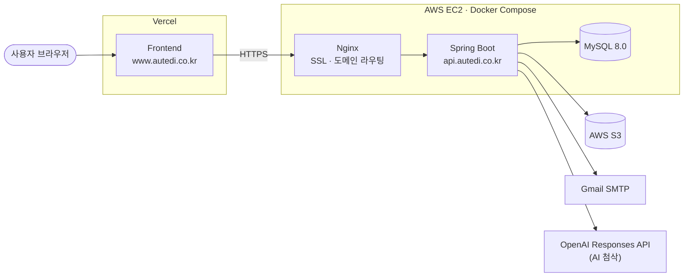

# AUTEDI SERVER
영어 도서관 및 영어 교육기관의 학생 글쓰기 첨삭 업무를 효율화하는 AI 기반 첨삭 서비스 `AUTEDI`의 백엔드 서버입니다.

## 아키텍처

## 팀원

<table>
  <tr>
    <td align="center"><a href="https://github.com/zzulYH-11"><b>전유하</b></a></td>
    <td align="center"><a href="https://github.com/taiho0303-blip"><b>정태호</b></a></td>
  </tr>
  <tr>
    <td align="center"></td>
    <td align="center"></td>
  </tr>
  <tr>
    <td align="center">Backend Developer</td>
    <td align="center">Backend Developer</td>
  </tr>
  <tr>
    <td align="center"><a href="https://github.com/zzulYH-11">@zzulYH-11</a></td>
    <td align="center"><a href="https://github.com/taiho0303-blip">@taiho0303-blip</a></td>
  </tr>
</table>
