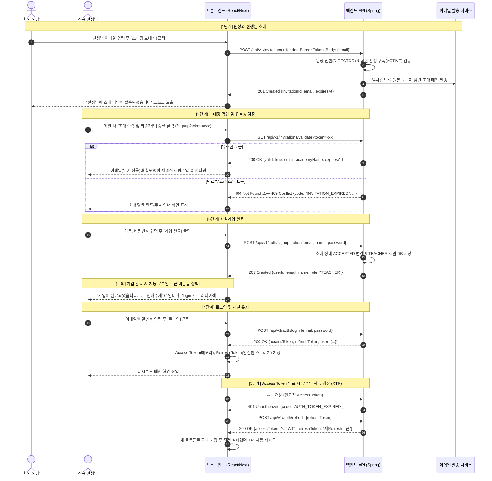

# AUTEDI 백엔드 통합 API 명세서 (API Specifications)

- **문서 버전**: v2.0.0
- **최종 수정일**: 2026-10-30
- **대상 모듈**: `AUTEDI-backend` (Spring Boot 4.x / Java 21)
- **Base URL**: `/api/v1`
- **대상 도메인 (전 도메인 통합, 총 26종 엔드포인트)**: 
  - **F01**: 계정 인증 및 선생님 초대 (Auth & Invitation) — 7종
  - **F02**: 학습지 파일 관리 (Worksheet File Management) — 3종
  - **F03**: 첨삭 설정 (Worksheet Settings) — 2종
  - **F04**: AI 첨삭 생성 및 재시도 (AI Generation & Retry) — 3종
  - **F05**: 검토 화면 및 AI 첨삭 편집/삭제/복원 (Review & Correction Editing) — 6종
  - **F06**: 교사 코멘트 작성/조회/수정/삭제 (Teacher Comments) — 5종
- **단일 진실 공급원(SSOT)**: 본 문서는 AUTEDI 백엔드에 실제 구현된 F01~F06 핵심 엔드포인트 26종의 정식 통합 명세서입니다.

---

## 목차 (Table of Contents)

1. [개요 및 공통 규약 (Overview & Standards)](#1-개요-및-공통-규약)
   - 1.1 환경 및 Base URL
   - 1.2 인증 및 인가 체계 (JWT Bearer & RTR Refresh Token)
   - 1.3 회원 권한 및 학원 구독 상태 정책
   - 1.4 표준 공통 응답 봉투 (`ApiResponse<T>`)
   - 1.5 동시성 제어 및 단위별 ETag 규약
   - 1.6 생성 작업 멱등성 보장 (`Idempotency-Key`)
   - 1.7 학습지 및 첨삭 생애주기 상태 머신
   - 1.8 프론트엔드 회원가입 및 인증 연동 플로우
2. [API 전체 목록 요약 (Summary Table)](#2-api-전체-목록-요약)
3. [F01 계정 인증 및 선생님 초대 API 명세 (7종)](#3-f01-계정-인증-회원가입-및-초대-api-명세-7종)
   - 3.1 [POST] `/api/v1/invitations` — 선생님 이메일 초대 발송
   - 3.2 [GET] `/api/v1/invitations/validate` — 초대 토큰 검증 및 학원 정보 조회
   - 3.3 [POST] `/api/v1/auth/signup` — 초대 기반 선생님 회원가입
   - 3.4 [POST] `/api/v1/auth/login` — 이메일/비밀번호 로그인
   - 3.5 [POST] `/api/v1/auth/refresh` — Access Token 재발급 (RTR)
   - 3.6 [POST] `/api/v1/auth/logout` — 로그아웃 (토큰 무효화)
   - 3.7 [GET] `/api/v1/users/me` — 현재 로그인 사용자 세션 조회
4. [F02 학습지 파일 관리 API 명세 (3종)](#4-f02-학습지-파일-관리-api-명세-3종)
   - 4.1 [POST] `/api/v1/worksheets` — 학습지 파일 업로드 등록
   - 4.2 [GET] `/api/v1/worksheets/{worksheetId}` — 학습지 상세 조회
   - 4.3 [PUT] `/api/v1/worksheets/{worksheetId}/file` — 학습지 파일 교체
5. [F03 첨삭 설정 API 명세 (2종)](#5-f03-첨삭-설정-api-명세-2종)
   - 5.1 [GET] `/api/v1/worksheets/{worksheetId}/settings` — 첨삭 설정 조회
   - 5.2 [PUT] `/api/v1/worksheets/{worksheetId}/settings` — 첨삭 설정 전체 교체/저장
6. [F04 AI 첨삭 생성 API 명세 (3종)](#6-f04-ai-첨삭-생성-api-명세-3종)
   - 6.1 [POST] `/api/v1/worksheets/{worksheetId}/generations` — AI 첨삭 생성 접수
   - 6.2 [GET] `/api/v1/worksheets/{worksheetId}/generations/{generationId}` — 생성 작업 상태 조회
   - 6.3 [POST] `/api/v1/worksheets/{worksheetId}/generations/{generationId}/retry` — 실패 작업 재시도
7. [F05 검토 화면 및 AI 첨삭 편집 API 명세 (6종)](#7-f05-검토-화면-및-ai-첨삭-편집-api-명세-6종)
   - 7.1 [GET] `/api/v1/worksheets/{worksheetId}/review` — 검토 화면 통합 조회
   - 7.2 [GET] `/api/v1/worksheets/{worksheetId}/corrections` — 첨삭 목록 필터 조회
   - 7.3 [GET] `/api/v1/worksheets/{worksheetId}/corrections/{correctionId}` — 첨삭 단건 조회
   - 7.4 [PATCH] `/api/v1/worksheets/{worksheetId}/corrections/{correctionId}` — 첨삭 내용 수정
   - 7.5 [DELETE] `/api/v1/worksheets/{worksheetId}/corrections/{correctionId}` — 첨삭 논리 삭제
   - 7.6 [POST] `/api/v1/worksheets/{worksheetId}/corrections/{correctionId}/restore` — 첨삭 삭제 취소/복원
8. [F06 교사 코멘트 API 명세 (5종)](#8-f06-교사-코멘트-api-명세-5종)
   - 8.1 [GET] `/api/v1/worksheets/{worksheetId}/comments` — 코멘트 목록 조회
   - 8.2 [GET] `/api/v1/worksheets/{worksheetId}/comments/{commentId}` — 코멘트 단건 조회
   - 8.3 [POST] `/api/v1/worksheets/{worksheetId}/comments` — 코멘트 신규 작성
   - 8.4 [PATCH] `/api/v1/worksheets/{worksheetId}/comments/{commentId}` — 코멘트 내용 수정
   - 8.5 [DELETE] `/api/v1/worksheets/{worksheetId}/comments/{commentId}` — 코멘트 삭제
9. [상태 머신 및 작업 허용/차단 매트릭스](#9-상태-머신-및-작업-허용차단-매트릭스)
10. [공통 데이터 모델 및 DTO 명세](#10-공통-데이터-모델-및-dto-명세)
11. [표준 에러 코드 일람 (Error Code Catalog)](#11-표준-에러-코드-일람)
12. [프론트엔드 연동 구현 레퍼런스 (Frontend Best Practices)](#12-프론트엔드-연동-구현-레퍼런스-frontend-best-practices)
13. [cURL 요청 예시 (Examples)](#13-curl-요청-예시)

---

## 1. 개요 및 공통 규약

### 1.1 환경 및 Base URL
- **Local Dev Server**: `http://localhost:8080`
- **배포 서버**: `https://api.autedi.com` (상대 경로 `/` 지원)
- **Base URL**: `/api/v1`
- **통신 포맷**: `application/json; charset=UTF-8`

### 1.2 인증 및 인가 체계
- **인증 방식**: Spring Security 6 기반의 Stateless JWT Bearer 토큰 인증을 수행합니다.
  - 요청 헤더: `Authorization: Bearer <accessToken>`
  - Access Token 유효기간: 1시간
  - Access Token 클레임: `sub` (userId), `email`, `role` (`ROLE_DIRECTOR` | `ROLE_TEACHER`), `academyId`
- **Refresh Token Rotation (RTR) 원칙**:
  - Refresh Token 유효기간: 14일 (SecureRandom 256-bit Base64 URL-safe)
  - 서버 DB에는 SHA-256 해시값만 저장하여 토큰 탈취 시에도 DB 보안을 보장합니다.
  - 토큰 재발급(`POST /api/v1/auth/refresh`) 시 기존 Refresh Token은 즉시 무효화되며 새로운 Access Token과 Refresh Token이 쌍으로 발급됩니다.
- **멀티 테넌시 격리 (Multi-Tenant Isolation)**:
  - 서버는 요청 헤더의 JWT 클레임에서 주입된 `CustomUserPrincipal`의 `academyId`를 기반으로 모든 데이터베이스 조회를 엄격히 제한합니다 (`findByIdAndAcademyId`).
  - 요청자가 소속되지 않은 타 학원의 자원 접근 시도 시, 보안상 존재 여부를 은닉하기 위해 일관되게 `404 Not Found` (`WORKSHEET_001` 등)를 반환합니다.

### 1.3 회원 권한 및 학원 구독 상태 정책
- **회원 역할 (Role)**:
  - `DIRECTOR`: 학원 대표원장 (선생님 초대 권한 보유, 학원 자원 총괄)
  - `TEACHER`: 학원 소속 선생님 (초대를 통해 가입)
- **학원 구독 상태 (Subscription Status)**:
  - `ACTIVE`: 유료 이용권 정상 활성 상태
  - `EXPIRED`: 유료 이용권 만료
  - `SUSPENDED`: 학원 계정 정지
  > [!IMPORTANT]
  > 학원 구독이 만료(`EXPIRED`)되거나 정지(`SUSPENDED`)되어도 **로그인 및 기존 학습지 조회/검토는 업무 연속성을 위해 정상 허용**됩니다. 단, 신규 쓰기/연산 작업(선생님 초대장 발송, 학습지 파일 업로드, AI 첨삭 생성 등) 호출 시에는 백엔드에서 `403 Forbidden` (`ACADEMY_SUBSCRIPTION_INACTIVE`)으로 차단됩니다.

### 1.4 표준 공통 응답 봉투 (`ApiResponse<T>`)
AUTEDI의 모든 RESTful API 응답은 일관된 JSON 봉투(Envelope) 구조를 준수합니다.

```json
{
  "isSuccess": true,
  "code": "COMMON_200",
  "message": "요청이 성공적으로 처리되었습니다.",
  "result": { ... },
  "error": null
}
```

- **성공 응답 필드**: `isSuccess: true`, `code: "COMMON_200"`, `message: 안내문구`, `result: DTO 객체`, `error: null`
- **실패 응답 필드**: `isSuccess: false`, `code: 에러식별코드`, `message: 에러원인설명`, `result: null`, `error: 상세에러목록 또는 null`

### 1.5 동시성 제어 및 단위별 ETag 규약
자원의 특성에 따라 개별적인 ETag 네이밍 및 JPA 낙관적 락(`@Version`)을 적용하여 다중 사용자의 동시 편집 충돌(Lost Update)을 완벽히 방어합니다.
- **학습지 마스터 ETag**: `""ws_{worksheetId}-v{version}""`
- **첨삭 설정 ETag**: `""settings_{worksheetId}-v{version}""`
- **단일 첨삭 자원 ETag**: `""cor_{correctionId}-v{version}""`
- **단일 코멘트 자원 ETag**: `""com_{commentId}-v{version}""`

> [!IMPORTANT]
> 자원 갱신(`PUT`, `PATCH`, `DELETE`) 요청 시 이전 조회 시 발급받은 ETag 문자열을 `If-Match` 헤더에 담아 전송해야 합니다. 서버 버전과 불일치하거나 누락된 경우 `412 Precondition Failed` (`COMMON_412`)가 발생합니다.

### 1.6 생성 작업 멱등성 보장 (`Idempotency-Key`)
- AI 생성 접수(`POST /api/v1/worksheets/{id}/generations`) 및 재시도(`POST .../retry`) 호출 시 네트워크 순단으로 인한 재전송이나 교사의 더블 클릭 시 중복 AI 호출을 방지하기 위해 `Idempotency-Key` 헤더를 지원합니다.
- 이미 접수된 멱등 키가 존재할 경우 중복 실행하지 않고 기존 작업(`GenerationResponse`)을 즉시 반환(Cache Hit)합니다.

### 1.7 학습지 및 첨삭 생애주기 상태 머신
- **WorksheetStatus**: `DRAFT` ➔ `PROCESSING` ➔ `READY` / `FAILED`
  - `DRAFT`: 최초 업로드 직후. 첨삭 설정 선택 및 파일 교체 가능.
  - `PROCESSING`: AI 비동기 파이프라인 실행 중. 전체 변경 잠금.
  - `READY`: 첨삭 생성 완료. **검토(F05) 및 코멘트(F06) 작업 필수 전제 조건**. 파일 교체/설정 수정 불가.
  - `FAILED`: AI 파이프라인 처리 실패. 파일 교체, 설정 수정, 동일 파일 재시도 가능.
- **CorrectionStatus**: `ACTIVE` ➔ `DELETED` ➔ `ACTIVE` (소프트 딜리트 및 복원 가능)

### 1.8 프론트엔드 회원가입 및 인증 연동 플로우

---

---

## 2. API 전체 목록 요약 (Summary Table)

| 분류 | 메서드 | 엔드포인트 | 인증/권한 | ETag / 헤더 | 기능 요약 |
| :--- | :--- | :--- | :--- | :--- | :--- |
| **F01. 초대** | `POST` | `/api/v1/invitations` | `ROLE_DIRECTOR` | - | 선생님 이메일 초대 링크 발송 |
| **F01. 초대** | `GET` | `/api/v1/invitations/validate` | `Public` | - | 초대장 토큰 유효성 검증 및 학원명 조회 |
| **F01. 인증** | `POST` | `/api/v1/auth/signup` | `Public` | - | 초대받은 선생님 계정 가입 완료 |
| **F01. 인증** | `POST` | `/api/v1/auth/login` | `Public` | - | 이메일/비밀번호 로그인 및 토큰 쌍 발급 |
| **F01. 인증** | `POST` | `/api/v1/auth/refresh` | `Public` | - | Access Token 재발급 (RTR 적용) |
| **F01. 인증** | `POST` | `/api/v1/auth/logout` | `Authenticated` | - | 로그아웃 및 Refresh Token 폐기 |
| **F01. 세션** | `GET` | `/api/v1/users/me` | `Authenticated` | - | 내 프로필, 권한, 소속 학원 세션 정보 조회 |
| **F02. 파일** | `POST` | `/api/v1/worksheets` | `Authenticated` | ETag 발급 | 학습지 원본 파일(JPG/PNG/PDF) 업로드 등록 |
| **F02. 파일** | `GET` | `/api/v1/worksheets/{worksheetId}` | `Authenticated` | ETag 반환 | 학습지 메타데이터 및 페이지 미리보기 조회 |
| **F02. 파일** | `PUT` | `/api/v1/worksheets/{worksheetId}/file` | `Authenticated` | `If-Match` | DRAFT/FAILED 학습지 파일 교체 |
| **F03. 설정** | `GET` | `/api/v1/worksheets/{worksheetId}/settings` | `Authenticated` | ETag 반환 | 첨삭 영역 및 AI 개입 수준 설정 조회 |
| **F03. 설정** | `PUT` | `/api/v1/worksheets/{worksheetId}/settings` | `Authenticated` | `If-Match` | 첨삭 영역 및 수준 전체 교체/저장 |
| **F04. 생성** | `POST` | `/api/v1/worksheets/{worksheetId}/generations` | `Authenticated` | `Idempotency-Key` | AI 첨삭 생성 비동기 작업 접수 |
| **F04. 생성** | `GET` | `/api/v1/worksheets/{worksheetId}/generations/{generationId}` | `Authenticated` | - | AI 생성 작업 진행 상태(Status/Progress) 폴링 |
| **F04. 생성** | `POST` | `/api/v1/worksheets/{worksheetId}/generations/{generationId}/retry` | `Authenticated` | `Idempotency-Key` | 실패(FAILED)한 AI 첨삭 작업 재시도 |
| **F05. 검토** | `GET` | `/api/v1/worksheets/{worksheetId}/review` | `Authenticated` | - | 검토 화면 통합 조회 (학습지, 생성, 첨삭, 코멘트) |
| **F05. 첨삭** | `GET` | `/api/v1/worksheets/{worksheetId}/corrections` | `Authenticated` | - | 첨삭 항목 목록 필터 조회 (상태, 영역, 페이지) |
| **F05. 첨삭** | `GET` | `/api/v1/worksheets/{worksheetId}/corrections/{correctionId}` | `Authenticated` | ETag 반환 | 첨삭 단건 상세 조회 |
| **F05. 첨삭** | `PATCH` | `/api/v1/worksheets/{worksheetId}/corrections/{correctionId}` | `Authenticated` | `If-Match` | 교사의 AI 첨삭 내용(content) 수정 |
| **F05. 첨삭** | `DELETE`| `/api/v1/worksheets/{worksheetId}/corrections/{correctionId}` | `Authenticated` | `If-Match` | 첨삭 항목 논리 삭제 (소프트 딜리트) |
| **F05. 첨삭** | `POST` | `/api/v1/worksheets/{worksheetId}/corrections/{correctionId}/restore` | `Authenticated` | `If-Match` | 삭제된 첨삭 항목 복원 (ACTIVE 전환) |
| **F06. 코멘트**| `GET` | `/api/v1/worksheets/{worksheetId}/comments` | `Authenticated` | - | 교사 코멘트 목록 조회 |
| **F06. 코멘트**| `GET` | `/api/v1/worksheets/{worksheetId}/comments/{commentId}` | `Authenticated` | ETag 반환 | 교사 코멘트 단건 상세 조회 |
| **F06. 코멘트**| `POST` | `/api/v1/worksheets/{worksheetId}/comments` | `Authenticated` | ETag 발급 | 특정 페이지 영역에 교사 코멘트 신규 등록 |
| **F06. 코멘트**| `PATCH` | `/api/v1/worksheets/{worksheetId}/comments/{commentId}` | `Authenticated` | `If-Match` | 교사 코멘트 내용 수정 |
| **F06. 코멘트**| `DELETE`| `/api/v1/worksheets/{worksheetId}/comments/{commentId}` | `Authenticated` | `If-Match` | 교사 코멘트 삭제 (소프트 딜리트) |

---


## 3. F01 계정 인증, 회원가입 및 초대 API 명세 (7종)
### 3.1 [POST] `/api/v1/invitations` — 선생님 이메일 초대 발송
원장이 특정 선생님의 이메일 주소를 입력하여 학원 소속 선생님으로 초대장을 생성하고 초대 링크 메일을 발송합니다.  
단건 발송 방식이며, 동일 이메일로 이미 발송된 대기 중인 초대가 있다면 기존 초대는 자동으로 취소(`REVOKED`)되고 신규 초대장이 발급됩니다.
- **HTTP Method**: `POST`
- **Endpoint**: `/api/v1/invitations`
- **Authorization**: `Bearer <accessToken>` 필수 (`ROLE_DIRECTOR` 전용)
#### Request Header

| Header 명 | 값 | 필수 | 설명 |
| --- | --- | --- | --- |
| `Authorization` | `Bearer eyJhbGciOi...` | O | 원장의 Access Token |
| `Content-Type` | `application/json` | O | JSON 데이터 전송 |

#### Request Body
```json
{
  "email": "teacher@example.com"
}
```

| 필드명 | 타입 | 필수 | 제약 조건 | 설명 |
| --- | --- | --- | --- | --- |
| `email` | `string` | O | RFC 5322 이메일 규격, 최대 255자 | 초대받을 선생님의 수신 이메일 주소 |

#### Success Response (`201 Created`)
```json
{
  "invitationId": 12,
  "email": "teacher@example.com",
  "status": "PENDING",
  "expiresAt": "2026-10-30T18:00:00"
}
```

| 필드명 | 타입 | 설명 |
| --- | --- | --- |
| `invitationId` | `number` | 생성된 초대 레코드 고유 ID |
| `email` | `string` | 초대한 선생님 이메일 주소 |
| `status` | `string` | 초대 상태 (`PENDING`: 대기 중) |
| `expiresAt` | `string (ISO-8601)` | 초대 링크 만료 일시 (발송 시점 + 24시간) |

#### Error Responses
- **`400 Bad Request`**: 이메일 유효성 검증 실패
```json
{
  "code": "COMMON_INVALID_INPUT",
  "message": "올바른 이메일 형식을 입력해주세요.",
  "status": 400,
  "timestamp": "2026-10-29T10:05:00",
  "errors": [
    {
      "field": "email",
      "value": "invalid-email",
      "reason": "올바른 이메일 주소 형식이 아닙니다."
    }
  ]
}
```
- **`401 Unauthorized`**: 토큰 만료 또는 누락 (`code: "AUTH_UNAUTHORIZED"`)
- **`403 Forbidden`**** (권한 부족)**: 원장 계정이 아님
```json
{
  "code": "AUTH_ACCESS_DENIED",
  "message": "선생님 초대는 학원 원장 권한만 가능합니다.",
  "status": 403,
  "timestamp": "2026-10-29T10:05:00"
}
```
- **`403 Forbidden`**** (학원 구독 만료)**: 학원 상태가 `ACTIVE`가 아님
```json
{
  "code": "SUBSCRIPTION_PAYMENT_REQUIRED",
  "message": "학원 이용권이 만료되어 초대 기능을 사용할 수 없습니다. 결제 상태를 확인해주세요.",
  "status": 403,
  "timestamp": "2026-10-29T10:05:00"
}
```
- **`409 Conflict`**** (이미 가입된 회원)**:
```json
{
  "code": "USER_ALREADY_EXISTS",
  "message": "이미 서비스에 가입된 이메일 계정입니다.",
  "status": 409,
  "timestamp": "2026-10-29T10:05:00"
}
```
---
### 3.2 [GET] `/api/v1/invitations/validate` — 초대 토큰 검증 및 학원 정보 조회
선생님이 이메일 링크(`https://.../signup?token=rawToken`)를 클릭하여 가입 페이지에 진입했을 때, 해당 초대 토큰이 유효한지 검증하고 가입 폼에 바인딩할 초대 이메일과 학원명을 반환합니다.
- **HTTP Method**: `GET`
- **Endpoint**: `/api/v1/invitations/validate`
- **Authorization**: 없음 (공개 API)
#### Query Parameters

| 파라미터명 | 타입 | 필수 | 설명 |
| --- | --- | --- | --- |
| `token` | `string` | O | 메일 링크에 포함된 원본 초대 토큰 문자열 |

*요청 예시*: `GET /api/v1/invitations/validate?token=6f0a3e2b1c8d4e9f90a1b2c3d4e5f6a7`
#### Success Response (`200 OK`)
```json
{
  "valid": true,
  "email": "teacher@example.com",
  "academyName": "에이플러스 수학학원",
  "expiresAt": "2026-10-30T18:00:00"
}
```

| 필드명 | 타입 | 설명 |
| --- | --- | --- |
| `valid` | `boolean` | 토큰 유효 여부 (`true`) |
| `email` | `string` | 초대 대상 선생님 이메일 (가입 폼에 `readonly`로 자동 입력) |
| `academyName` | `string` | 초대된 학원명 (화면 상단 안내용: "○○학원에 초대되셨습니다") |
| `expiresAt` | `string (ISO-8601)` | 초대 링크 만료 일시 |

#### Error Responses
- **`400 Bad Request`**: `token` 쿼리 파라미터가 누락된 경우 (`code: "COMMON_INVALID_INPUT"`)
- **`404 Not Found`**: 토큰이 데이터베이스에 존재하지 않는 경우
```json
{
  "code": "INVITATION_NOT_FOUND",
  "message": "존재하지 않거나 올바르지 않은 초대 링크입니다.",
  "status": 404,
  "timestamp": "2026-10-29T10:10:00"
}
```
- **`409 Conflict`**** (만료됨)**: 24시간이 경과하여 만료된 경우
```json
{
  "code": "INVITATION_EXPIRED",
  "message": "초대 링크의 유효시간(24시간)이 만료되었습니다. 원장님께 재초대를 요청해주세요.",
  "status": 409,
  "timestamp": "2026-10-29T10:10:00"
}
```
- **`409 Conflict`**** (이미 가입 완료)**:
```json
{
  "code": "INVITATION_ALREADY_ACCEPTED",
  "message": "이미 가입이 완료된 초대 링크입니다. 로그인해주세요.",
  "status": 409,
  "timestamp": "2026-10-29T10:10:00"
}
```
- **`409 Conflict`**** (취소/재발송됨)**:
```json
{
  "code": "INVITATION_REVOKED",
  "message": "원장님에 의해 재발송되었거나 취소된 초대 링크입니다. 가장 최근 메일을 확인해주세요.",
  "status": 409,
  "timestamp": "2026-10-29T10:10:00"
}
```
---
### 3.3 [POST] `/api/v1/auth/signup` — 초대 기반 선생님 회원가입
초대 검증을 통과한 선생님이 자신의 이름과 비밀번호를 입력하여 계정을 생성합니다.  
보안상 `role`은 서버에서 `'TEACHER'`로 고정 부여되며, 소속 학원 또한 초대장에 귀속된 학원으로 자동 매핑됩니다.  
가입 완료 직후에는 자동 로그인 토큰이 발급되지 않으므로, 프론트엔드는 가입 성공 후 로그인 페이지로 이동시켜 사용자가 직접 로그인하도록 유도해야 합니다.
- **HTTP Method**: `POST`
- **Endpoint**: `/api/v1/auth/signup`
- **Authorization**: 없음 (공개 API)
#### Request Header

| Header 명 | 값 | 필수 | 설명 |
| --- | --- | --- | --- |
| `Content-Type` | `application/json` | O | JSON 데이터 전송 |

#### Request Body
```json
{
  "token": "6f0a3e2b1c8d4e9f90a1b2c3d4e5f6a7",
  "email": "teacher@example.com",
  "name": "김선생",
  "password": "Password123!"
}
```

| 필드명 | 타입 | 필수 | 제약 조건 | 설명 |
| --- | --- | --- | --- | --- |
| `token` | `string` | O | 비어있지 않음 | 검증받은 원본 초대 토큰 |
| `email` | `string` | O | 초대장의 이메일과 완전 일치 | 가입할 이메일 주소 |
| `name` | `string` | O | 2자 이상 50자 이하 | 선생님 실명/이름 |
| `password` | `string` | O | 8자 이상 30자 이하, 영문+숫자+특수문자 조합 | 로그인 비밀번호 |

#### Success Response (`201 Created`)
```json
{
  "userId": 45,
  "email": "teacher@example.com",
  "name": "김선생",
  "role": "TEACHER"
}
```

| 필드명 | 타입 | 설명 |
| --- | --- | --- |
| `userId` | `number` | 생성된 회원 고유 식별자 |
| `email` | `string` | 가입된 이메일 계정 |
| `name` | `string` | 가입된 이름 |
| `role` | `string` | 부여된 권한 (항상 `"TEACHER"`) |

> **프론트엔드 연동 팁**:
> 가입 성공 응답을 받은 즉시 `"회원가입이 완료되었습니다. 로그인 화면으로 이동합니다."` 알림을 띄우고 `/login` 페이지로 라우팅해주세요.
#### Error Responses
- **`400 Bad Request`**: 비밀번호 규칙 미충족 또는 초대 이메일 불일치
```json
{
  "code": "COMMON_INVALID_INPUT",
  "message": "비밀번호는 영문, 숫자, 특수문자를 포함하여 8자 이상이어야 합니다.",
  "status": 400,
  "timestamp": "2026-10-29T10:15:00",
  "errors": [
    {
      "field": "password",
      "value": "1234",
      "reason": "8자 이상의 비밀번호를 입력해주세요."
    }
  ]
}
```
- **`404 Not Found`**: 유효하지 않은 초대 토큰 (`code: "INVITATION_NOT_FOUND"`)
- **`409 Conflict`**: 이미 존재하는 이메일 계정이거나 초대장이 이미 사용/만료됨 (`code: "USER_ALREADY_EXISTS"`, `"INVITATION_ALREADY_ACCEPTED"`, `"INVITATION_EXPIRED"`)
---
### 3.4 [POST] `/api/v1/auth/login` — 이메일 / 비밀번호 로그인
이메일과 비밀번호로 로그인하여 Access Token(JWT)과 Refresh Token, 그리고 사용자 프로필 및 학원 구독 상태 정보를 획득합니다.  
학원 구독이 만료(`EXPIRED`)되었더라도 원장 및 소속 교사는 로그인이 가능하며, `user.subscriptionStatus` 필드를 통해 현재 학원 상태를 즉시 파악할 수 있습니다.
- **HTTP Method**: `POST`
- **Endpoint**: `/api/v1/auth/login`
- **Authorization**: 없음 (공개 API)
#### Request Header

| Header 명 | 값 | 필수 | 설명 |
| --- | --- | --- | --- |
| `Content-Type` | `application/json` | O | JSON 데이터 전송 |

#### Request Body
```json
{
  "email": "teacher@example.com",
  "password": "Password123!"
}
```

| 필드명 | 타입 | 필수 | 설명 |
| --- | --- | --- | --- |
| `email` | `string` | O | 회원 이메일 주소 |
| `password` | `string` | O | 계정 비밀번호 |

#### Success Response (`200 OK`)
```json
{
  "accessToken": "eyJhbGciOiJIUzI1NiIsInR5cCI6IkpXVCJ9.eyJzdWIiOiI0NSIsImVtYWlsIjoidGVhY2hlckBleGFtcGxlLmNvbSIsInJvbGUiOiJST0xFX1RFQUNIRVIiLCJhY2FkZW15SWQiOjEsImV4cCI6MTc5MzI3NDQwMH0.xxxxxx",
  "refreshToken": "7d9b4c0e-f432-4d89-b754-1b3a24e7a89f",
  "user": {
    "userId": 45,
    "email": "teacher@example.com",
    "name": "김선생",
    "role": "TEACHER",
    "academyId": 1,
    "academyName": "에이플러스 수학학원",
    "subscriptionStatus": "ACTIVE"
  }
}
```

| 필드명 | 타입 | 설명 |
| --- | --- | --- |
| `accessToken` | `string` | 1시간 유효한 JWT 토큰. 이후 모든 인가 요청 헤더에 삽입 |
| `refreshToken` | `string` | 14일 유효한 리프레시 토큰 원본 문자열 |
| `user.userId` | `number` | 회원 고유 식별자 |
| `user.email` | `string` | 회원 이메일 |
| `user.name` | `string` | 회원 이름 |
| `user.role` | `string` | 회원 권한 (`"DIRECTOR"`: 원장, `"TEACHER"`: 교사) |
| `user.academyId` | `number` | 소속 학원 고유 식별자 |
| `user.academyName` | `string` | 소속 학원 이름 |
| `user.subscriptionStatus` | `string` | 학원 구독 상태 (`"ACTIVE"`, `"EXPIRED"`, `"SUSPENDED"`) |

#### Error Responses
- **`400 Bad Request`**: 이메일 또는 비밀번호 누락 (`code: "COMMON_INVALID_INPUT"`)
- **`401 Unauthorized`**** (인증 실패)**: 이메일 미존재 또는 비밀번호 불일치
```json
{
  "code": "AUTH_INVALID_CREDENTIALS",
  "message": "이메일 또는 비밀번호가 일치하지 않습니다.",
  "status": 401,
  "timestamp": "2026-10-29T10:20:00"
}
```
- **`403 Forbidden`**** (계정 잠금/비활성화)**:
```json
{
  "code": "AUTH_ACCOUNT_LOCKED",
  "message": "계정이 잠금 처리되었습니다. 관리자에게 문의하세요.",
  "status": 403,
  "timestamp": "2026-10-29T10:20:00"
}
```
---
### 3.5 [POST] `/api/v1/auth/refresh` — 토큰 재발급 (Refresh Token Rotation)
Access Token이 만료(`401 Unauthorized`, `AUTH_TOKEN_EXPIRED`)되었을 때, 보유 중인 Refresh Token을 전송하여 새로운 Access Token과 새로운 Refresh Token을 재발급받습니다.  
보안 강화를 위해 기존에 제시된 Refresh Token은 즉시 무효화(`revoked`)되며 새 토큰으로 회전(Rotation)됩니다.
- **HTTP Method**: `POST`
- **Endpoint**: `/api/v1/auth/refresh`
- **Authorization**: 없음 (공개 API)
#### Request Header

| Header 명 | 값 | 필수 | 설명 |
| --- | --- | --- | --- |
| `Content-Type` | `application/json` | O | JSON 데이터 전송 |

#### Request Body
```json
{
  "refreshToken": "7d9b4c0e-f432-4d89-b754-1b3a24e7a89f"
}
```

| 필드명 | 타입 | 필수 | 설명 |
| --- | --- | --- | --- |
| `refreshToken` | `string` | O | 기존에 발급받아 보관 중이던 리프레시 토큰 원본 |

#### Success Response (`200 OK`)
```json
{
  "accessToken": "eyJhbGciOiJIUzI1NiIsInR5cCI6IkpXVCJ9.eyJzdWIiOiI0NSIsImVtYWlsIjoidGVhY2hlckBleGFtcGxlLmNvbSIsInJvbGUiOiJST0xFX1RFQUNIRVIiLCJhY2FkZW15SWQiOjEsImV4cCI6MTc5MzI3ODAwMH0.yyyyyy",
  "refreshToken": "8e0c5d1f-g543-5e90-c865-2c4b35f8b90a"
}
```

| 필드명 | 타입 | 설명 |
| --- | --- | --- |
| `accessToken` | `string` | 새롭게 발급된 1시간 유효 JWT Access Token |
| `refreshToken` | `string` | 새롭게 회전(Rotation) 발급된 14일 유효 Refresh Token |

> **프론트엔드 연동 팁**:
> 응답으로 반환된 새 `refreshToken`으로 스토리지 값을 반드시 갱신해야 합니다. 이전 토큰은 폐기되었으므로 다시 사용 시 `AUTH_TOKEN_REVOKED` 에러가 발생합니다.
#### Error Responses
- **`400 Bad Request`**: `refreshToken` 필드 누락 (`code: "COMMON_INVALID_INPUT"`)
- **`401 Unauthorized`**** (만료됨)**:
```json
{
  "code": "AUTH_TOKEN_EXPIRED",
  "message": "리프레시 토큰이 만료되었습니다. 다시 로그인해주세요.",
  "status": 401,
  "timestamp": "2026-10-29T10:25:00"
}
```
- **`401 Unauthorized`**** (폐기/위조/재사용 감지)**:
```json
{
  "code": "AUTH_TOKEN_REVOKED",
  "message": "이미 사용되었거나 무효화된 리프레시 토큰입니다. 다시 로그인해주세요.",
  "status": 401,
  "timestamp": "2026-10-29T10:25:00"
}
```
- **`403 Forbidden`**: 사용자 계정이 정지 상태인 경우 (`code: "AUTH_ACCOUNT_LOCKED"`)
---
### 3.6 [POST] `/api/v1/auth/logout` — 로그아웃 (토큰 무효화)
사용자가 로그아웃할 때 서버에 저장된 Refresh Token을 즉시 만료(`revoked_at = NOW()`) 처리하여 탈취된 토큰을 통한 재발급을 영구적으로 방지합니다.
- **HTTP Method**: `POST`
- **Endpoint**: `/api/v1/auth/logout`
- **Authorization**: `Bearer <accessToken>` 필수
#### Request Header

| Header 명 | 값 | 필수 | 설명 |
| --- | --- | --- | --- |
| `Authorization` | `Bearer eyJhbGciOi...` | O | 현재 회원의 Access Token |
| `Content-Type` | `application/json` | O | JSON 데이터 전송 |

#### Request Body
```json
{
  "refreshToken": "8e0c5d1f-g543-5e90-c865-2c4b35f8b90a"
}
```

| 필드명 | 타입 | 필수 | 설명 |
| --- | --- | --- | --- |
| `refreshToken` | `string` | O | 폐기할 현재 기기의 리프레시 토큰 |

#### Success Response (`200 OK`)
```json
{
  "message": "성공적으로 로그아웃되었습니다."
}
```
> **프론트엔드 연동 팁**:
> 백엔드 응답을 받은 후, 프론트엔드 스토리지(LocalStorage/Cookie/Memory)에 남아있는 `accessToken` 및 `refreshToken`을 모두 삭제하고 `/login` 화면으로 이동해주세요.
#### Error Responses
- **`401 Unauthorized`**: Access Token이 만료되거나 유효하지 않은 경우 (`code: "AUTH_UNAUTHORIZED"`)
- **`400 Bad Request`**: 요청 본문 오류 (`code: "COMMON_INVALID_INPUT"`)
---
### 3.7 [GET] `/api/v1/users/me` — 현재 로그인 사용자 및 소속 학원 정보 조회
현재 로그인한 사용자의 최신 정보, 권한(`DIRECTOR` / `TEACHER`), 소속 학원명 및 학원 이용권 만료 일시를 조회합니다.  
브라우저 새로고침이나 앱 초기 렌더링 시 전역 사용자 상태(`userStore`)를 복원할 때 사용합니다.
- **HTTP Method**: `GET`
- **Endpoint**: `/api/v1/users/me`
- **Authorization**: `Bearer <accessToken>` 필수
#### Request Header

| Header 명 | 값 | 필수 | 설명 |
| --- | --- | --- | --- |
| `Authorization` | `Bearer eyJhbGciOi...` | O | 현재 회원의 Access Token |

#### Success Response (`200 OK`)
```json
{
  "userId": 45,
  "email": "teacher@example.com",
  "name": "김선생",
  "role": "TEACHER",
  "academyId": 1,
  "academyName": "에이플러스 수학학원",
  "subscriptionStatus": "ACTIVE",
  "planExpiresAt": "2026-12-31T23:59:59",
  "lastLoginAt": "2026-10-29T10:20:00"
}
```

| 필드명 | 타입 | 설명 |
| --- | --- | --- |
| `userId` | `number` | 회원 고유 ID |
| `email` | `string` | 회원 이메일 |
| `name` | `string` | 회원 이름 |
| `role` | `string` | 회원 역할 (`"DIRECTOR"`, `"TEACHER"`) |
| `academyId` | `number` | 소속 학원 ID |
| `academyName` | `string` | 소속 학원명 |
| `subscriptionStatus` | `string` | 학원 구독 상태 (`"ACTIVE"`, `"EXPIRED"`, `"SUSPENDED"`) |
| `planExpiresAt` | `string (ISO-8601)` 또는 `null` | 학원 이용권 만료 시각 |
| `lastLoginAt` | `string (ISO-8601)` | 마지막 로그인 시각 |

#### Error Responses
- **`401 Unauthorized`**: 토큰 만료 또는 인증 실패 (`code: "AUTH_UNAUTHORIZED"`, `AUTH_TOKEN_EXPIRED`)
- **`403 Forbidden`**: 계정이 잠금 처리된 경우 (`code: "AUTH_ACCOUNT_LOCKED"`)
- **`404 Not Found`**: 회원 정보가 DB에 존재하지 않는 경우 (`code: "USER_NOT_FOUND"`)
---

---

## 4. F02 학습지 파일 관리 API 명세 (3종)

---

### 8.1 [POST] `/api/v1/worksheets` — 학습지 파일 업로드 등록

신규 학생 손글씨 과제 파일(이미지 또는 PDF)을 업로드하고, 학습지 마스터 레코드 및 기본 1페이지 정보를 생성합니다.

- **Method / URL**: `POST /api/v1/worksheets`
- **Content-Type**: `multipart/form-data`
- **Headers**: `Authorization: Bearer <token>` (필수)
- **Request Body**:
  - `file`: `MultipartFile` (필수, 허용: JPG, JPEG, PNG, PDF)
- **Response**: `201 Created`
  - **Headers**: `Location: /api/v1/worksheets/{id}`, `ETag: "\"ws_{id}-v1\""`
  - **Body Example**:
```json
{
  "isSuccess": true,
  "code": "COMMON_200",
  "message": "학습지가 등록되었습니다.",
  "result": {
    "id": 1,
    "etag": "\"ws_1-v1\"",
    "status": "DRAFT",
    "file": {
      "name": "homework.png",
      "mediaType": "image/png",
      "sizeBytes": 1542380,
      "originalUrl": "http://localhost:8080/files/worksheets/1/a1b2c3d4-e5f6.png",
      "urlExpiresAt": null
    },
    "pages": [
      {
        "id": 1,
        "pageNumber": 1,
        "width": 1200,
        "height": 1600,
        "imageUrl": "http://localhost:8080/files/worksheets/1/a1b2c3d4-e5f6.png",
        "urlExpiresAt": null
      }
    ],
    "settings": {
      "etag": "\"settings_1-v1\"",
      "areas": []
    },
    "latestGenerationId": null,
    "createdAt": "2026-10-29T14:20:00",
    "updatedAt": "2026-10-29T14:20:00"
  },
  "error": null
}
```
- **주요 에러**: 400 (`FILE_001`), 401 (`AUTH_001`), 403 (`ACADEMY_002`), 415 (`FILE_002`), 500 (`FILE_003`)

---

### 8.2 [GET] `/api/v1/worksheets/{worksheetId}` — 학습지 상세 조회

학습지 원본 파일 정보, 페이지 목록, 현재 설정된 첨삭 영역 목록, 최신 AI 생성 작업 ID를 한 번에 조회합니다.

- **Method / URL**: `GET /api/v1/worksheets/{worksheetId}`
- **Headers**: `Authorization: Bearer <token>`
- **Path Variable**: `worksheetId` (Long, 필수)
- **Response**: `200 OK`, `ETag: "\"ws_{id}-v{version}\""`, Body: `ApiResponse<WorksheetDetailResponse>`
- **주요 에러**: 401 (`AUTH_001`), 404 (`WORKSHEET_001`)

---

### 8.3 [PUT] `/api/v1/worksheets/{worksheetId}/file` — 학습지 파일 교체

등록된 학습지의 원본 이미지/PDF 파일을 신규 파일로 교체합니다.

- **Method / URL**: `PUT /api/v1/worksheets/{worksheetId}/file`
- **Content-Type**: `multipart/form-data`
- **Headers**: `Authorization: Bearer <token>`, `If-Match: String` (선택적)
- **Path Variable**: `worksheetId` (Long, 필수)
- **Request Body**: `file`: `MultipartFile` (필수)
- **상태 제약**: `DRAFT` 또는 `FAILED`에서만 허용. `PROCESSING`/`READY` 시 `409 Conflict` (`WORKSHEET_002`).
- **정합성 처리**: 파일 교체 시 기존 페이지 OCR 캐시(`ocrResult`, `ocrFileHash`) 무조건 `null` 무효화, 상태는 `DRAFT`로 리셋, 첨삭 설정(`WorksheetSetting`)은 보존.
- **Response**: `200 OK`, `ETag: "\"ws_{id}-v{version+1}\""`, Body: `ApiResponse<WorksheetDetailResponse>`
- **주요 에러**: 400 (`FILE_001`), 404 (`WORKSHEET_001`), 409 (`WORKSHEET_002`), 412 (`COMMON_412`), 415 (`FILE_002`)

---

## 5. F03 첨삭 설정 API 명세 (2종)

---

### 7.1 [GET] `/api/v1/worksheets/{worksheetId}/settings` — 첨삭 설정 조회

- **Method / URL**: `GET /api/v1/worksheets/{worksheetId}/settings`
- **Headers**: `Authorization: Bearer <token>`
- **Response**: `200 OK`, `ETag: "\"settings_{id}-v{version}\""`, Body: `ApiResponse<WorksheetSettingsResponse>`

---

### 7.2 [PUT] `/api/v1/worksheets/{worksheetId}/settings` — 첨삭 설정 전체 교체/저장

- **Method / URL**: `PUT /api/v1/worksheets/{worksheetId}/settings`
- **Headers**: `Authorization: Bearer <token>`, `If-Match: String` (선택적)
- **Request Body**:
```json
{
  "areas": [
    { "area": "GRAMMAR_SPELLING", "level": "STANDARD" },
    { "area": "VOCABULARY_EXPRESSION", "level": "ADVANCED" }
  ]
}
```
- **제약 조건**: 1~4개 영역 (`@NotEmpty`, `@Size(max=4)`), 중복 영역 불가, `DRAFT`/`FAILED` 상태 필수.
- **Response**: `200 OK`, `ETag: "\"settings_{id}-v{version+1}\""`, Body: `ApiResponse<WorksheetSettingsResponse>`

---

## 6. F04 AI 첨삭 생성 API 명세 (3종)

---

### 8.1 [POST] `/api/v1/worksheets/{worksheetId}/generations` — AI 첨삭 생성 접수

- **Method / URL**: `POST /api/v1/worksheets/{worksheetId}/generations`
- **Headers**: `Authorization: Bearer <token>`, `Idempotency-Key: String` (선택/권장)
- **사전 조건**: `DRAFT` 또는 `FAILED` 상태, 설정 1개 이상 존재, 학원 구독 `ACTIVE`.
- **Response**: `202 Accepted`, `Location: /api/v1/worksheets/{id}/generations/{genId}`, Body: `ApiResponse<GenerationResponse>`

---

### 8.2 [GET] `/api/v1/worksheets/{worksheetId}/generations/{generationId}` — 생성 작업 상태 조회

- **Method / URL**: `GET /api/v1/worksheets/{worksheetId}/generations/{generationId}`
- **Response**: `200 OK`, Body: `ApiResponse<GenerationResponse>` (status, stage, attempt, error 등)

---

### 8.3 [POST] `/api/v1/worksheets/{worksheetId}/generations/{generationId}/retry` — 실패 작업 재시도

- **Method / URL**: `POST /api/v1/worksheets/{worksheetId}/generations/{generationId}/retry`
- **Headers**: `Authorization: Bearer <token>`, `Idempotency-Key: String` (선택)
- **사전 조건**: 대상 작업 `FAILED` 상태 필수, 원본 파일 해시 일치 필수.
- **Response**: `202 Accepted`, `Location: /api/v1/worksheets/{id}/generations/{newGenId}`, Body: `ApiResponse<GenerationResponse>`

---

## 7. F05 검토 화면 및 AI 첨삭 편집 API 명세 (6종)

---

### 7.1 [GET] `/api/v1/worksheets/{worksheetId}/review` — 검토 화면 통합 조회

AI 첨삭 완료 후 교사 검토 화면에서 필요한 학습지 정보, 최신 생성 작업 상태, 유효 첨삭 목록, 활성 교사 코멘트 목록을 1회의 요청으로 일괄 반환합니다.

#### 요청 개요
- **HTTP Method**: `GET`
- **Request URL**: `/api/v1/worksheets/{worksheetId}/review`
- **Headers**: `Authorization: Bearer <token>` (필수)
- **Path Variable**: `worksheetId` (Long, 필수)

#### 비즈니스 로직 및 상태 제약
- **READY 상태 필수**: 학습지의 상태가 `WorksheetStatus.READY`가 아닌 경우 `409 Conflict` (`WORKSHEET_002`, "학습지가 검토 준비 완료(READY) 상태가 아닙니다.") 에러를 반환합니다.
- **유효 데이터만 집계**:
  - `corrections`: 논리 삭제되지 않은 `ACTIVE` 상태의 첨삭 카드만 포함.
  - `comments`: `deleted_at == null`인 활성 교사 코멘트만 포함 (`createdAt` 오름차순).

#### 응답 바디 (Response Body) — `200 OK`
```json
{
  "isSuccess": true,
  "code": "COMMON_200",
  "message": "성공입니다.",
  "result": {
    "worksheet": {
      "id": 1,
      "etag": "\"ws_1-v2\"",
      "status": "READY",
      "file": {
        "name": "student_hw.png",
        "mediaType": "image/png",
        "sizeBytes": 1542380,
        "originalUrl": "http://localhost:8080/files/worksheets/1/a1b2c3d4-e5f6.png",
        "urlExpiresAt": null
      },
      "pages": [
        {
          "id": 1,
          "pageNumber": 1,
          "width": 1200,
          "height": 1600,
          "imageUrl": "http://localhost:8080/files/worksheets/1/a1b2c3d4-e5f6.png",
          "urlExpiresAt": null
        }
      ],
      "settings": {
        "etag": "\"settings_1-v2\"",
        "areas": [
          { "area": "GRAMMAR_SPELLING", "level": "STANDARD" }
        ]
      },
      "latestGenerationId": 10,
      "createdAt": "2026-10-29T14:20:00",
      "updatedAt": "2026-10-29T14:30:10"
    },
    "generation": {
      "id": 10,
      "worksheetId": 1,
      "status": "SUCCEEDED",
      "stage": "COMPLETED",
      "attempt": 1,
      "retryOfGenerationId": null,
      "settingsSnapshot": [
        { "area": "GRAMMAR_SPELLING", "level": "STANDARD" }
      ],
      "createdAt": "2026-10-29T14:30:00",
      "startedAt": "2026-10-29T14:30:01",
      "finishedAt": "2026-10-29T14:30:08",
      "error": null
    },
    "corrections": [
      {
        "id": 101,
        "etag": "\"cor_101-v1\"",
        "generationId": 10,
        "source": "AI",
        "area": "GRAMMAR_SPELLING",
        "originalText": "He go to school.",
        "aiInitialContent": "He goes to school.",
        "content": "He goes to school.",
        "explanation": "주어가 3인칭 단수이므로 goes를 사용해야 합니다.",
        "regions": [
          {
            "pageId": 1,
            "x": 0.25,
            "y": 0.35,
            "width": 0.08,
            "height": 0.03,
            "polygon": null
          }
        ],
        "editedByTeacher": false,
        "explanationStale": false,
        "status": "ACTIVE",
        "createdAt": "2026-10-29T14:30:05",
        "updatedAt": "2026-10-29T14:30:05"
      }
    ],
    "comments": [
      {
        "id": 201,
        "etag": "\"com_201-v1\"",
        "source": "TEACHER",
        "pageId": 1,
        "highlightType": "HIGHLIGHT",
        "regions": [
          {
            "pageId": 1,
            "x": 0.15,
            "y": 0.40,
            "width": 0.30,
            "height": 0.04,
            "polygon": null
          }
        ],
        "content": "도입부 구성이 훌륭합니다.",
        "createdAt": "2026-10-29T14:35:00",
        "updatedAt": "2026-10-29T14:35:00"
      }
    ]
  },
  "error": null
}
```

---

### 7.2 [GET] `/api/v1/worksheets/{worksheetId}/corrections` — 첨삭 목록 필터 조회

학습지의 AI 첨삭 목록을 상태, 페이지 번호, 영역별로 필터링하여 조회합니다.

#### 요청 개요
- **HTTP Method**: `GET`
- **Request URL**: `/api/v1/worksheets/{worksheetId}/corrections`
- **Headers**: `Authorization: Bearer <token>`
- **Query Parameters**:
  | 파라미터 | 필수 | 타입 | 기본값 | 설명 |
  | :--- | :---: | :--- | :--- | :--- |
  | `status` | 선택 | String | `ACTIVE` | 조회할 첨삭 상태 (`ACTIVE`, `DELETED`, `ALL`) |
  | `pageId` | 선택 | Long | - | 특정 페이지의 첨삭 항목만 필터링 |
  | `area` | 선택 | Enum | - | `GRAMMAR_SPELLING`, `VOCABULARY_EXPRESSION`, `SENTENCE_STRUCTURE`, `CONTENT_SUMMARY` |

#### 비즈니스 로직
- 학습지 `READY` 상태 필수 검증.
- `status` 파라미터가 없으면 활성 항목(`ACTIVE`)만 반환되며, `DELETED` 전달 시 삭제 항목(휴지통 뷰) 조회 가능.

#### 응답 바디 (Response Body) — `200 OK`
```json
{
  "isSuccess": true,
  "code": "COMMON_200",
  "message": "성공입니다.",
  "result": {
    "items": [
      {
        "id": 101,
        "etag": "\"cor_101-v1\"",
        "generationId": 10,
        "source": "AI",
        "area": "GRAMMAR_SPELLING",
        "originalText": "He go to school.",
        "aiInitialContent": "He goes to school.",
        "content": "He goes to school.",
        "explanation": "주어가 3인칭 단수이므로 goes를 사용해야 합니다.",
        "regions": [
          { "pageId": 1, "x": 0.25, "y": 0.35, "width": 0.08, "height": 0.03, "polygon": null }
        ],
        "editedByTeacher": false,
        "explanationStale": false,
        "status": "ACTIVE",
        "createdAt": "2026-10-29T14:30:05",
        "updatedAt": "2026-10-29T14:30:05"
      }
    ],
    "total": 1
  },
  "error": null
}
```

---

### 7.3 [GET] `/api/v1/worksheets/{worksheetId}/corrections/{correctionId}` — 첨삭 단건 조회

단일 첨삭 카드의 상세 정보와 전용 ETag를 조회합니다. (DELETED 상태의 항목도 조회 가능)

- **Method / URL**: `GET /api/v1/worksheets/{worksheetId}/corrections/{correctionId}`
- **Headers**: `Authorization: Bearer <token>`
- **Response**: `200 OK`
  - **Headers**: `ETag: "\"cor_{id}-v{version}\""`
  - **Body**: `ApiResponse<CorrectionResponse>`

---

### 7.4 [PATCH] `/api/v1/worksheets/{worksheetId}/corrections/{correctionId}` — 첨삭 내용 수정

교사가 AI 추천 수정문(`content`)을 직접 편집합니다.

#### 요청 개요
- **HTTP Method**: `PATCH`
- **Request URL**: `/api/v1/worksheets/{worksheetId}/corrections/{correctionId}`
- **Content-Type**: `application/json`
- **Headers**: 
  - `Authorization: Bearer <token>` (필수)
  - `If-Match: "\"cor_{id}-v{version}\""` (**필수**, 동시 편집 충돌 방지)

#### Request Body (`application/json`)
```json
{
  "content": "He goes to school every morning."
}
```

#### 비즈니스 로직 및 정책
1. **READY 상태 검증**: 학습지가 `READY` 상태여야 함.
2. **If-Match 검증**: 누락 또는 버전 불일치 시 `412 Precondition Failed` (`COMMON_412`).
3. **삭제 상태 수정 차단**: 첨삭 항목이 `DELETED` 상태인 경우 `409 Conflict` (`CORRECTION_002`, "삭제된 첨삭 항목은 수정할 수 없습니다.") 차단. (복원 후 수정 가능)
4. **원본 불변 및 플래그 갱신**:
   - `originalText`, `aiInitialContent`, `explanation`은 영구 보존.
   - `content`만 변경되며 `isEdited = true` 설정.
   - 응답 DTO에서 `editedByTeacher = true`, `explanationStale = true`로 반환.
   - 낙관적 락 버전이 증가하며 새 ETag 발급.

#### 응답 바디 (Response Body) — `200 OK`
```json
{
  "isSuccess": true,
  "code": "COMMON_200",
  "message": "첨삭 내용이 수정되었습니다.",
  "result": {
    "id": 101,
    "etag": "\"cor_101-v2\"",
    "generationId": 10,
    "source": "AI",
    "area": "GRAMMAR_SPELLING",
    "originalText": "He go to school.",
    "aiInitialContent": "He goes to school.",
    "content": "He goes to school every morning.",
    "explanation": "주어가 3인칭 단수이므로 goes를 사용해야 합니다.",
    "regions": [
      { "pageId": 1, "x": 0.25, "y": 0.35, "width": 0.08, "height": 0.03, "polygon": null }
    ],
    "editedByTeacher": true,
    "explanationStale": true,
    "status": "ACTIVE",
    "createdAt": "2026-10-29T14:30:05",
    "updatedAt": "2026-10-29T14:40:00"
  },
  "error": null
}
```

---

### 7.5 [DELETE] `/api/v1/worksheets/{worksheetId}/corrections/{correctionId}` — 첨삭 논리 삭제

부적절한 AI 첨삭 카드를 논리 삭제(소프트 딜리트)합니다.

- **Method / URL**: `DELETE /api/v1/worksheets/{worksheetId}/corrections/{correctionId}`
- **Headers**: `Authorization: Bearer <token>`, `If-Match: String` (**필수**)
- **비즈니스 로직**:
  - `status = DELETED`, `deletedAt = NOW()` 설정.
  - 이미 `DELETED`인 경우 멱등하게 `204 No Content` 반환.
- **Response**: `204 No Content`
  - **Headers**: `ETag: "\"cor_{id}-v{version+1}\""` (바디 없음)

---

### 7.6 [POST] `/api/v1/worksheets/{worksheetId}/corrections/{correctionId}/restore` — 첨삭 삭제 취소/복원

삭제된 첨삭 카드를 다시 `ACTIVE` 상태로 복원합니다.

- **Method / URL**: `POST /api/v1/worksheets/{worksheetId}/corrections/{correctionId}/restore`
- **Headers**: `Authorization: Bearer <token>`, `If-Match: String` (**필수**)
- **비즈니스 로직**:
  - `status = ACTIVE`, `deletedAt = null` 설정.
  - **이전에 교사가 수정한 내용(`content`) 및 `isEdited` 플래그는 온전히 유지**됨.
- **Response**: `200 OK`, `ETag: "\"cor_{id}-v{version+1}\""`, Body: `ApiResponse<CorrectionResponse>` ("첨삭 삭제가 취소되었습니다.")

---

## 8. F06 교사 코멘트 API 명세 (5종)

---

### 8.1 [GET] `/api/v1/worksheets/{worksheetId}/comments` — 코멘트 목록 조회

삭제되지 않은 활성 코멘트 목록을 작성 일시(`createdAt`) 오름차순으로 조회합니다.

- **Method / URL**: `GET /api/v1/worksheets/{worksheetId}/comments`
- **Query Parameter**: `pageId` (Long, 선택 — 특정 페이지 코멘트만 필터링)
- **Response**: `200 OK`, Body: `ApiResponse<CommentListResponse>`
```json
{
  "isSuccess": true,
  "code": "COMMON_200",
  "message": "성공입니다.",
  "result": {
    "items": [
      {
        "id": 201,
        "etag": "\"com_201-v1\"",
        "source": "TEACHER",
        "pageId": 1,
        "highlightType": "HIGHLIGHT",
        "regions": [
          { "pageId": 1, "x": 0.15, "y": 0.40, "width": 0.30, "height": 0.04, "polygon": null }
        ],
        "content": "도입부 구성이 훌륭합니다.",
        "createdAt": "2026-10-29T14:35:00",
        "updatedAt": "2026-10-29T14:35:00"
      }
    ],
    "total": 1
  },
  "error": null
}
```

---

### 8.2 [GET] `/api/v1/worksheets/{worksheetId}/comments/{commentId}` — 코멘트 단건 조회

- **Method / URL**: `GET /api/v1/worksheets/{worksheetId}/comments/{commentId}`
- **제약**: 삭제된 코멘트(`deleted_at != null`) 조회 시 `404 Not Found` (`COMMENT_001`).
- **Response**: `200 OK`, `ETag: "\"com_{id}-v{version}\""`, Body: `ApiResponse<CommentResponse>`

---

### 8.3 [POST] `/api/v1/worksheets/{worksheetId}/comments` — 코멘트 신규 작성

손글씨 과제물의 특정 위치에 하이라이트/밑줄 영역을 지정하고 교사 코멘트를 등록합니다.

#### 요청 개요
- **HTTP Method**: `POST`
- **Request URL**: `/api/v1/worksheets/{worksheetId}/comments`
- **Content-Type**: `application/json`
- **Headers**: `Authorization: Bearer <token>` (필수)

#### Request Body (`application/json`)
```json
{
  "pageId": 1,
  "highlightType": "HIGHLIGHT",
  "regions": [
    {
      "pageId": 1,
      "x": 0.15,
      "y": 0.40,
      "width": 0.30,
      "height": 0.04
    }
  ],
  "content": "이 문장의 표현이 매우 참신하고 좋습니다. 훌륭해요!"
}
```

#### 파라미터 제약 및 검증
- `pageId`: `@NotNull`, 학습지에 존재하는 유효 페이지 ID (`PAGE_001` 404).
- `highlightType`: `HIGHLIGHT`, `UNDERLINE` 둘 중 하나 필수.
- `regions`: 최소 1개 이상 필수. 내부의 `region.pageId`는 상위 `pageId`와 반드시 일치해야 함 (불일치 시 `400 Bad Request`, `COMMENT_002`).
- `content`: `@NotBlank`, 공백만 있는 문자열 차단.
- 작성자(`user`)는 Security Context에서 서버가 자동 주입.

#### 응답 헤더 및 바디 — `201 Created`
- **Headers**: `Location: /api/v1/worksheets/{worksheetId}/comments/{commentId}`, `ETag: "\"com_{id}-v1\""`
- **Body**: `ApiResponse<CommentResponse>` ("코멘트가 작성되었습니다.")

---

### 8.4 [PATCH] `/api/v1/worksheets/{worksheetId}/comments/{commentId}` — 코멘트 내용 수정

등록된 코멘트의 텍스트 내용(`content`)을 수정합니다.

- **Method / URL**: `PATCH /api/v1/worksheets/{worksheetId}/comments/{commentId}`
- **Headers**: `Authorization: Bearer <token>`, `If-Match: String` (**필수**)
- **Request Body**:
```json
{
  "content": "이 문장의 표현이 매우 참신하고 논리적입니다."
}
```
- **정책**: 텍스트 내용(`content`)만 수정 가능하며, 영역 좌표(`regions`)나 강조 유형(`highlightType`)은 불변.
- **Response**: `200 OK`, `ETag: "\"com_{id}-v{version+1}\""`, Body: `ApiResponse<CommentResponse>`

---

### 8.5 [DELETE] `/api/v1/worksheets/{worksheetId}/comments/{commentId}` — 코멘트 삭제

코멘트를 논리 삭제 처리합니다.

- **Method / URL**: `DELETE /api/v1/worksheets/{worksheetId}/comments/{commentId}`
- **Headers**: `Authorization: Bearer <token>`, `If-Match: String` (**필수**)
- **비즈니스 로직**: `deleted_at = NOW()` 설정. 삭제된 코멘트는 이후 목록 및 단건 조회에서 배제됨.
- **Response**: `204 No Content` (바디 없음)

---

## 9. 상태 머신 및 작업 허용/차단 매트릭스

| 엔드포인트 / 작업 | DRAFT | PROCESSING | READY | FAILED |
| :--- | :---: | :---: | :---: | :---: |
| **상세 조회 (`GET /worksheets/{id}`)** | 허용 | 허용 | 허용 | 허용 |
| **파일 교체 (`PUT /worksheets/{id}/file`)** | **허용** | **차단 (`WORKSHEET_002`)** | **차단 (`WORKSHEET_002`)** | **허용** |
| **설정 조회/교체 (F03 Settings)** | **허용** | **차단 (`WORKSHEET_002`)** | **차단 (`WORKSHEET_002`)** | **허용** |
| **AI 생성 접수 (`POST /generations`)** | **허용** | **차단 (`GENERATION_001`)** | **차단 (`GENERATION_002`)** | **허용** |
| **작업 재시도 (`POST /retry`)** | 차단 | 차단 | 차단 | **허용 (`GENERATION_005`)** |
| **검토 화면 통합 조회 (`GET /review`)** | **차단 (409)** | **차단 (409)** | **허용 (200)** | **차단 (409)** |
| **첨삭 목록/단건 조회 (F05)** | 차단 | 차단 | **허용** | 차단 |
| **첨삭 수정/삭제/복원 (F05)** | 차단 | 차단 | **허용** | 차단 |
| **교사 코멘트 작성/조회/수정/삭제 (F06)** | 차단 | 차단 | **허용** | 차단 |

---

## 10. 공통 데이터 모델 및 DTO 명세

### 10.1 계정 인증 및 초대 관련 DTO (F01)

#### `InvitationCreateRequest`
```typescript
interface InvitationCreateRequest {
  email: string; // 초대할 선생님 이메일 (예: "teacher@autedi.com")
}
```

#### `InvitationResponse`
```typescript
interface InvitationResponse {
  id: number; // 초대장 고유 ID (예: 1)
  email: string; // 수신자 이메일
  status: "PENDING" | "ACCEPTED" | "EXPIRED" | "REVOKED";
  expiresAt: string; // 만료 시각 (ISO 8601, 예: "2026-10-31T17:00:00")
  createdAt: string; // 발송 일시
}
```

#### `InvitationValidateResponse`
```typescript
interface InvitationValidateResponse {
  isValid: boolean; // 토큰 유효 여부 (true)
  email: string; // 초대된 이메일 (회원가입 폼 고정값)
  academyName: string; // 소속 학원명 (예: "에이플러스 어학원")
  expiresAt: string; // 토큰 만료 일시
}
```

#### `SignupRequest`
```typescript
interface SignupRequest {
  token: string; // 이메일로 받은 원본 초대 토큰
  name: string; // 선생님 성명 (예: "김선생")
  password: string; // 계정 비밀번호 (영문, 숫자, 특수문자 조합 8~20자)
}
```

#### `SignupResponse`
```typescript
interface SignupResponse {
  userId: number; // 생성된 회원 ID (예: 2)
  email: string; // 가입된 이메일
  name: string; // 선생님 성명
  role: "ROLE_DIRECTOR" | "ROLE_TEACHER";
  academyId: number; // 소속 학원 ID (예: 1)
  academyName: string; // 소속 학원명
}
```

#### `LoginRequest`
```typescript
interface LoginRequest {
  email: string; // 로그인 계정 이메일
  password: string; // 계정 비밀번호
}
```

#### `LoginResponse`
```typescript
interface LoginResponse {
  accessToken: string; // API 인가용 JWT Access Token (유효기간: 1시간)
  refreshToken: string; // 무중단 재발급용 불투명 Refresh Token (유효기간: 14일)
  tokenType: string; // "Bearer"
  expiresIn: number; // 만료 잔여 초 (3600)
  user: {
    id: number;
    email: string;
    name: string;
    role: "DIRECTOR" | "TEACHER";
    academyId: number;
    academyName: string;
    subscriptionStatus: "ACTIVE" | "EXPIRED" | "SUSPENDED";
  };
}
```

#### `TokenRefreshRequest` & `TokenRefreshResponse`
```typescript
interface TokenRefreshRequest {
  refreshToken: string; // 기존 발급된 유효한 Refresh Token
}

interface TokenRefreshResponse {
  accessToken: string; // 새로 발급된 JWT Access Token
  refreshToken: string; // RTR 원칙에 의해 새로 갱신된 신규 Refresh Token
  tokenType: string; // "Bearer"
  expiresIn: number; // 3600
}
```

#### `UserResponse`
```typescript
interface UserResponse {
  id: number;
  email: string;
  name: string;
  role: "DIRECTOR" | "TEACHER";
  academyId: number;
  academyName: string;
  subscriptionStatus: "ACTIVE" | "EXPIRED" | "SUSPENDED";
}
```


### 8.1 `CorrectionResponse`
| 필드명 | 타입 | Nullable | 설명 |
| :--- | :--- | :---: | :--- |
| `id` | Long | No | 첨삭 항목 식별자 PK |
| `etag` | String | No | 첨삭 카드 ETag (예: `"\"cor_101-v1\""`) |
| `generationId` | Long | Yes | 생성 작업 ID |
| `source` | String | No | 고정값 `"AI"` |
| `area` | Enum | No | `GRAMMAR_SPELLING`, `VOCABULARY_EXPRESSION`, `SENTENCE_STRUCTURE`, `CONTENT_SUMMARY` |
| `originalText` | String | No | 학생 작성 원본 텍스트 (불변) |
| `aiInitialContent` | String | No | AI 최초 추천 수정문 (불변) |
| `content` | String | No | 현재 적용된 최종 수정문 (교사 수정 시 갱신) |
| `explanation` | String | No | AI 문법/어휘 설명문 (불변) |
| `regions` | Array | No | 대상 영역 좌표 리스트 (`pageId`, `x`, `y`, `width`, `height`) |
| `editedByTeacher` | Boolean | No | 교사가 직접 수정한 경우 `true` |
| `explanationStale`| Boolean | No | 교사 수정으로 AI 설명과 불일치할 수 있음을 나타내는 경고 플래그 |
| `status` | Enum | No | `ACTIVE`, `DELETED` |
| `createdAt` / `updatedAt` | String | No | ISO-8601 일시 |

### 8.2 `CommentResponse`
| 필드명 | 타입 | Nullable | 설명 |
| :--- | :--- | :---: | :--- |
| `id` | Long | No | 코멘트 식별자 PK |
| `etag` | String | No | 코멘트 ETag (예: `"\"com_201-v1\""`) |
| `source` | String | No | 고정값 `"TEACHER"` |
| `pageId` | Long | No | 귀속 페이지 ID |
| `highlightType` | Enum | No | `HIGHLIGHT`, `UNDERLINE` |
| `regions` | Array | No | 강조 영역 좌표 리스트 |
| `content` | String | No | 교사 피드백 코멘트 내용 |
| `createdAt` / `updatedAt` | String | No | ISO-8601 일시 |

---

## 11. 표준 에러 코드 일람 (Error Code Reference)

| HTTP Status | 에러 코드 | 응답 메시지 예시 | 발생 상황 |
| :---: | :--- | :--- | :--- |
| **400** | `COMMON_001` | 요청 값이 올바르지 않습니다. | DTO 검증 실패, 공백 전송, 파라미터 타입 불일치 |
| **400** | `FILE_001` | 업로드할 파일이 비어 있습니다. | 0바이트 파일 업로드 |
| **400** | `GENERATION_004` | 첨삭 영역을 최소 한 개 선택해 주세요. | 설정 없이 생성 요청 |
| **400** | `COMMENT_002` | 코멘트 영역의 페이지가 대상 페이지와 일치하지 않습니다. | `regions` 내부 `pageId` 불일치 |
| **401** | `AUTH_001` | 인증이 필요합니다. | 토큰 누락 또는 서명 오류 |
| **403** | `ACADEMY_002` | 학원 유료 구독이 활성 상태가 아닙니다. | 만료된 학원의 쓰기 요청 |
| **404** | `WORKSHEET_001` | 학습지를 찾을 수 없거나 접근 권한이 없습니다. | 학습지 미존재 또는 타 학원 자원 |
| **404** | `GENERATION_003` | 생성 작업을 찾을 수 없습니다. | 생성 작업 ID 미존재 |
| **404** | `CORRECTION_001` | 첨삭 항목을 찾을 수 없습니다. | 첨삭 ID 미존재 또는 타 학습지 첨삭 |
| **404** | `COMMENT_001` | 코멘트를 찾을 수 없거나 이미 삭제되었습니다. | 코멘트 미존재 또는 삭제된 코멘트 |
| **404** | `PAGE_001` | 해당 페이지를 찾을 수 없습니다. | 유효하지 않은 `pageId` |
| **409** | `WORKSHEET_002` | 현재 학습지 상태에서는 요청한 작업을 수행할 수 없습니다. | 검토 화면/수정 요청 시 READY가 아니거나 교체 시 DRAFT가 아님 |
| **409** | `CORRECTION_002` | 삭제된 첨삭 항목은 수정할 수 없습니다. | `DELETED` 상태의 첨삭에 `PATCH` 호출 |
| **409** | `GENERATION_001` | 이미 생성 작업이 진행 중입니다. | 진행 중인 학습지에 생성 요청 |
| **409** | `GENERATION_002` | 이미 생성이 완료된 학습지입니다. | 완료된 학습지에 생성 요청 |
| **409** | `GENERATION_005` | 재시도할 수 없는 작업 상태이거나 파일/설정이 변경되었습니다. | 실패 작업이 아니거나 파일 해시 불일치 |
| **412** | `COMMON_412` | 데이터 버전이 변경되었습니다. 최신 데이터를 조회한 후 다시 시도해 주세요. | `If-Match` 헤더 누락 또는 ETag 불일치 |
| **415** | `FILE_002` | 지원하지 않는 파일 형식입니다. JPG, PNG, PDF 파일만 허용됩니다. | 비허용 파일 확장자 |
| **500** | `COMMON_003` | 서버 내부 오류가 발생했습니다. | 미처리 런타임 예외 |

---

## 12. 프론트엔드 연동 구현 레퍼런스 (Frontend Best Practices)
### 12.1 Axios 인스턴스 & 무중단 토큰 재발급(RTR) 인터셉터 예제 코드
```javascript
import axios from 'axios';

const api = axios.create({
  baseURL: process.env.NEXT_PUBLIC_API_URL || 'http://localhost:8080',
  timeout: 10000,
  headers: {
    'Content-Type': 'application/json',
  },
});

// 1. 요청 인터셉터: Access Token 자동 주입
api.interceptors.request.use(
  (config) => {
    const accessToken = localStorage.getItem('accessToken');
    if (accessToken && !config.headers.Authorization) {
      config.headers.Authorization = `Bearer ${accessToken}`;
    }
    return config;
  },
  (error) => Promise.reject(error)
);

// 2. 응답 인터셉터: 401 만료 시 Refresh Token Rotation 자동 수행
let isRefreshing = false;
let failedQueue = [];

const processQueue = (error, token = null) => {
  failedQueue.forEach((prom) => {
    if (error) {
      prom.reject(error);
    } else {
      prom.resolve(token);
    }
  });
  failedQueue = [];
};

api.interceptors.response.use(
  (response) => response,
  async (error) => {
    const originalRequest = error.config;

    // 토큰 만료 에러 감지 (401 & AUTH_TOKEN_EXPIRED)
    if (
      error.response?.status === 401 &&
      error.response?.data?.code === 'AUTH_TOKEN_EXPIRED' &&
      !originalRequest._retry
    ) {
      if (isRefreshing) {
        return new Promise((resolve, reject) => {
          failedQueue.push({ resolve, reject });
        })
          .then((token) => {
            originalRequest.headers.Authorization = `Bearer ${token}`;
            return api(originalRequest);
          })
          .catch((err) => Promise.reject(err));
      }

      originalRequest._retry = true;
      isRefreshing = true;

      const refreshToken = localStorage.getItem('refreshToken');
      if (!refreshToken) {
        window.location.href = '/login';
        return Promise.reject(error);
      }

      try {
        const { data } = await axios.post(
          `${api.defaults.baseURL}/api/v1/auth/refresh`,
          { refreshToken }
        );

        const { accessToken: newAccessToken, refreshToken: newRefreshToken } = data;
        localStorage.setItem('accessToken', newAccessToken);
        localStorage.setItem('refreshToken', newRefreshToken);

        api.defaults.headers.common.Authorization = `Bearer ${newAccessToken}`;
        originalRequest.headers.Authorization = `Bearer ${newAccessToken}`;

        processQueue(null, newAccessToken);
        return api(originalRequest);
      } catch (refreshError) {
        processQueue(refreshError, null);
        localStorage.removeItem('accessToken');
        localStorage.removeItem('refreshToken');
        window.location.href = '/login?expired=true';
        return Promise.reject(refreshError);
      } finally {
        isRefreshing = false;
      }
    }

    return Promise.reject(error);
  }
);

export default api;
```
### 12.2 프론트엔드 연동 시 필수 확인 체크리스트
- [ ] **초대 링크 라우팅**: 메일 링크 URL은 `/signup?token={rawToken}` 형태로 구성되며, 페이지 마운트 즉시 `GET /api/v1/invitations/validate?token=...`를 호출해야 합니다.
- [ ] **가입 후 자동 로그인 미지원**: 가입 API(`POST /api/v1/auth/signup`) 완료 후 바로 토큰이 나오지 않으므로, 로그인 페이지(`/login`)로 라우팅시켜 비밀번호로 로그인하게 하세요.
- [ ] **학원 구독 상태 UI 대응**: `login` 및 `users/me`의 응답에 `subscriptionStatus`가 `'EXPIRED'` 또는 `'SUSPENDED'`인 경우, 앱 상단에 "학원 이용권 만료 안내" 배너를 띄워 원장님께 연장 결제를 안내하세요.
- [ ] **원장 권한 제한 처리**: `/api/v1/invitations` 호출은 원장(`ROLE_DIRECTOR`)만 가능하므로 교사(`ROLE_TEACHER`) 계정 화면에서는 [선생님 초대] 메뉴를 숨김 처리해야 합니다.
- [ ] **로그아웃 시 스토리지 정리**: `POST /api/v1/auth/logout` 호출 후 성공 여부와 상관없이 브라우저 스토리지의 모든 토큰과 캐시된 유저 정보를 초기화하세요.

---

## 13. cURL 요청 예시 (Examples)

### 10.1 검토 화면 통합 조회 (GET)
```bash
curl -X GET "http://localhost:8080/api/v1/worksheets/1/review" \
  -H "Authorization: Bearer <access_token>"
```

### 10.2 첨삭 내용 수정 (PATCH)
```bash
curl -X PATCH "http://localhost:8080/api/v1/worksheets/1/corrections/101" \
  -H "Authorization: Bearer <access_token>" \
  -H "If-Match: \"cor_101-v1\"" \
  -H "Content-Type: application/json" \
  -d '{
    "content": "He goes to school every morning."
  }'
```

### 10.3 첨삭 논리 삭제 (DELETE)
```bash
curl -X DELETE "http://localhost:8080/api/v1/worksheets/1/corrections/101" \
  -H "Authorization: Bearer <access_token>" \
  -H "If-Match: \"cor_101-v1\""
```

### 10.4 첨삭 삭제 취소/복원 (POST)
```bash
curl -X POST "http://localhost:8080/api/v1/worksheets/1/corrections/101/restore" \
  -H "Authorization: Bearer <access_token>" \
  -H "If-Match: \"cor_101-v2\""
```

### 10.5 교사 코멘트 작성 (POST)
```bash
curl -X POST "http://localhost:8080/api/v1/worksheets/1/comments" \
  -H "Authorization: Bearer <access_token>" \
  -H "Content-Type: application/json" \
  -d '{
    "pageId": 1,
    "highlightType": "HIGHLIGHT",
    "regions": [
      {
        "pageId": 1,
        "x": 0.15,
        "y": 0.40,
        "width": 0.30,
        "height": 0.04
      }
    ],
    "content": "이 문장의 표현이 매우 참신하고 좋습니다. 훌륭해요!"
  }'
```

### 10.6 교사 코멘트 수정 (PATCH)
```bash
curl -X PATCH "http://localhost:8080/api/v1/worksheets/1/comments/201" \
  -H "Authorization: Bearer <access_token>" \
  -H "If-Match: \"com_201-v1\"" \
  -H "Content-Type: application/json" \
  -d '{
    "content": "이 문장의 표현이 매우 참신하고 논리적입니다."
  }'
```

### 10.7 교사 코멘트 삭제 (DELETE)
```bash
curl -X DELETE "http://localhost:8080/api/v1/worksheets/1/comments/201" \
  -H "Authorization: Bearer <access_token>" \
  -H "If-Match: \"com_201-v1\""
```
