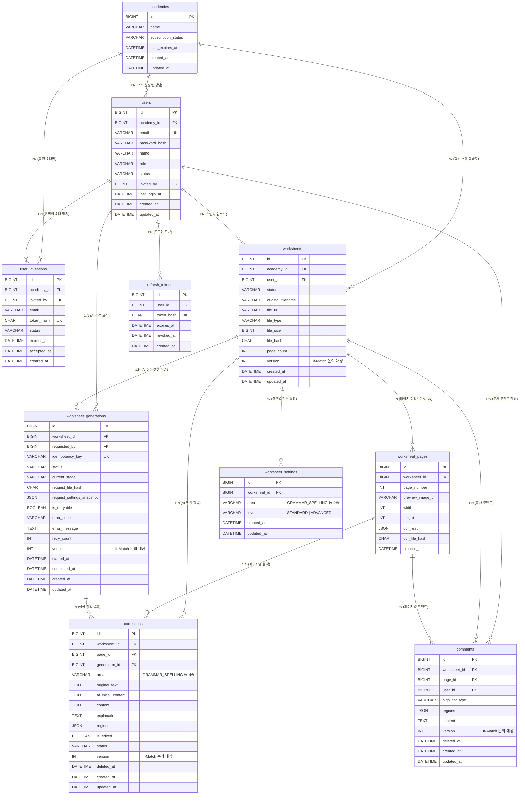

# ERD 초안

- **DBMS**: MySQL 8.0+ (InnoDB, `utf8mb4_0900_ai_ci`)
- **작성 기준**:
    1. **회원/인증 도메인**: 학원(유료 서비스 구독 단위), 최고 관리자(원장 - 개발자 직접 부여), 원장의 이메일 초대를 통한 선생님 회원가입, 이메일 기반 로그인
    2. **학습지/AI 첨삭 도메인**: 학습지 업로드 / 첨삭 설정(4개 영역 · 2개 수준) / AI 첨삭 생성 / 첨삭 검토 및 수정 / 교사 코멘트 API (총 19개 엔드포인트)

---

## 1. 전체 통합 ERD 구조도 (Mermaid)

---

## 2. 회원 및 인증 테이블 명세

### ① `academies` (학원 정보 및 유료 이용 상태)

> **역할**: 유료 서비스 구독 단위 및 소속 원장·선생님·학습지 데이터의 테넌트(조직) 격리
> 

| 필드명 | 데이터 타입 | NULL 허용 | 기본값 | 제약 조건 / 인덱스 | 설명 및 비즈니스 조건 |
| --- | --- | --- | --- | --- | --- |
| `id` | `BIGINT UNSIGNED` | X | `AUTO_INCREMENT` | **PK** | 학원 고유 ID (`academyId`) |
| `name` | `VARCHAR(100)` | X | - | - | 학원명 |
| `subscription_status` | `VARCHAR(20)` | X | `'ACTIVE'` | `INDEX` | 유료 서비스 상태 (`ACTIVE`: 이용중, `EXPIRED`: 만료, `SUSPENDED`: 정지) |
| `plan_expires_at` | `DATETIME(3)` | O | `NULL` | - | 유료 이용권 만료 일시 |
| `created_at` | `DATETIME(3)` | X | `CURRENT_TIMESTAMP(3)` | - | 등록 일시 |
| `updated_at` | `DATETIME(3)` | X | `CURRENT_TIMESTAMP(3)` | `ON UPDATE` | 수정 일시 |

---

### ② `users` (회원 — 원장 및 선생님)

> **역할**: 이메일을 ID로 사용하는 회원 테이블. 최고 관리자(원장)는 개발자가 직접 부여하고, 선생님은 원장의 초대 이메일을 통해 가입
> 

| 필드명 | 데이터 타입 | NULL 허용 | 기본값 | 제약 조건 / 인덱스 | 설명 및 비즈니스 조건 |
| --- | --- | --- | --- | --- | --- |
| `id` | `BIGINT UNSIGNED` | X | `AUTO_INCREMENT` | **PK** | 회원 고유 ID (`userId`) |
| `academy_id` | `BIGINT UNSIGNED` | X | - | **FK** (`academies.id`), `INDEX` | 소속 학원 ID |
| `email` | `VARCHAR(255)` | X | - | **UNIQUE** (`UK_users_email`) | 로그인 ID로 사용하는 이메일 |
| `password_hash` | `VARCHAR(255)` | X | - | - | 암호화(BCrypt/Argon2)된 비밀번호 |
| `name` | `VARCHAR(50)` | X | - | - | 회원 이름 (원장/선생님 실명) |
| `role` | `VARCHAR(20)` | X | `'TEACHER'` | `CHECK (role IN ('DIRECTOR', 'TEACHER'))` | 권한 (`DIRECTOR`: 최고 관리자/원장 — 개발자가 직접 부여, `TEACHER`: 선생님) |
| `status` | `VARCHAR(20)` | X | `'ACTIVE'` | `INDEX` | 계정 상태 (`ACTIVE`: 활성, `INACTIVE`: 비활성/퇴사, `LOCKED`: 잠김) |
| `invited_by` | `BIGINT UNSIGNED` | O | `NULL` | **FK** (`users.id`) | 초대한 원장의 `user_id` (개발자가 직접 생성한 원장 계정은 `NULL`) |
| `last_login_at` | `DATETIME(3)` | O | `NULL` | - | 마지막 로그인 일시 |
| `created_at` | `DATETIME(3)` | X | `CURRENT_TIMESTAMP(3)` | - | 가입 완료 일시 |
| `updated_at` | `DATETIME(3)` | X | `CURRENT_TIMESTAMP(3)` | `ON UPDATE` | 수정 일시 |

---

### ③ `user_invitations` (선생님 초대 이메일 관리)

> **역할**: 최고 관리자(원장)가 선생님에게 발송한 초대 이메일의 인증 토큰, 만료 시간, 가입 수락 여부를 관리
> 

| 필드명 | 데이터 타입 | NULL 허용 | 기본값 | 제약 조건 / 인덱스 | 설명 및 비즈니스 조건 |
| --- | --- | --- | --- | --- | --- |
| `id` | `BIGINT UNSIGNED` | X | `AUTO_INCREMENT` | **PK** | 초대 고유 ID (`invitationId`) |
| `academy_id` | `BIGINT UNSIGNED` | X | - | **FK** (`academies.id`) | 초대하는 학원 ID |
| `invited_by` | `BIGINT UNSIGNED` | X | - | **FK** (`users.id`) | 초대를 발송한 최고 관리자(원장) ID |
| `email` | `VARCHAR(255)` | X | - | `INDEX(email, status)` | 초대받을 선생님 이메일 |
| `token_hash` | `CHAR(64)` | X | - | **UNIQUE** (`UK_invitation_token`) | 초대 링크에 포함된 일회용 인증 토큰의 SHA-256 해시 |
| `status` | `VARCHAR(20)` | X | `'PENDING'` | `INDEX` | 초대 상태 (`PENDING`: 대기, `ACCEPTED`: 수락완료, `EXPIRED`: 만료, `REVOKED`: 취소) |
| `expires_at` | `DATETIME(3)` | X | - | - | 초대 링크 만료 일시 (예: 발송 후 48시간 또는 7일) |
| `accepted_at` | `DATETIME(3)` | O | `NULL` | - | 선생님이 링크를 통해 비밀번호 설정 및 가입을 완료한 시각 |
| `created_at` | `DATETIME(3)` | X | `CURRENT_TIMESTAMP(3)` | - | 초대 발송 일시 |

---

### ④ `refresh_tokens` (로그인 인증 토큰 관리)

> **역할**: 유료 서비스 비인가 접근 차단 및 로그아웃/계정 정지 시 즉시 토큰 무효화 처리
> 

| 필드명 | 데이터 타입 | NULL 허용 | 기본값 | 제약 조건 / 인덱스 | 설명 및 비즈니스 조건 |
| --- | --- | --- | --- | --- | --- |
| `id` | `BIGINT UNSIGNED` | X | `AUTO_INCREMENT` | **PK** | 토큰 고유 ID |
| `user_id` | `BIGINT UNSIGNED` | X | - | **FK** (`users.id`), `INDEX` | 소유 회원 ID |
| `token_hash` | `CHAR(64)` | X | - | **UNIQUE** | 발급된 Refresh Token 해시값 |
| `expires_at` | `DATETIME(3)` | X | - | `INDEX` | 토큰 만료 일시 |
| `revoked_at` | `DATETIME(3)` | O | `NULL` | - | 로그아웃 또는 강제 만료 처리 일시 (`NULL`이면 유효) |
| `created_at` | `DATETIME(3)` | X | `CURRENT_TIMESTAMP(3)` | - | 발급 일시 |

---

## 3. 학습지 및 AI 첨삭 테이블 명세

### ⑤ `worksheets` (학습지 마스터)

> **관련 API**: #1 업로드, #2 상세 조회, #3 파일 교체, #9 검토 화면 조회
> 

| 필드명 | 데이터 타입 | NULL 허용 | 기본값 | 제약 조건 / 인덱스 | 설명 및 비즈니스 조건 |
| --- | --- | --- | --- | --- | --- |
| `id` | `BIGINT UNSIGNED` | X | `AUTO_INCREMENT` | **PK** | 학습지 고유 ID (`worksheetId`) |
| `academy_id` | `BIGINT UNSIGNED` | X | - | **FK** (`academies.id`), `INDEX` | 소속 학원 ID (학원 단위 학습지 접근 제어) |
| `user_id` | `BIGINT UNSIGNED` | X | - | **FK** (`users.id`), `INDEX` | 학습지를 업로드/생성한 회원(선생님/원장) ID |
| `status` | `VARCHAR(30)` | X | `'READY'` | `INDEX` | 학습지 상태 (`READY`: 생성 전, `GENERATING`: 생성 중, `COMPLETED`: 완료, `FAILED`: 실패)※ #3 파일 교체, #5 설정 변경은 `READY`, `FAILED`에서만 허용 |
| `original_filename` | `VARCHAR(255)` | X | - | - | 업로드한 원본 파일명 |
| `file_url` | `VARCHAR(500)` | X | - | - | 스토리지(S3 등)에 저장된 원본 파일 경로 |
| `file_type` | `VARCHAR(10)` | X | - | `CHECK` | 파일 확장자/형식 (`JPG`, `JPEG`, `PNG`, `PDF`만 허용) |
| `file_size` | `BIGINT UNSIGNED` | X | - | - | 파일 크기 (Byte) |
| `file_hash` | `CHAR(64)` | X | - | - | 원본 파일 SHA-256 해시 (#8 재시도 시 파일 변경 여부 검증 및 OCR 재사용 판별용) |
| `page_count` | `INT UNSIGNED` | X | `1` | - | 총 페이지 수 (초기 MVP는 1장, 추후 다중 PNG/PDF 업로드 시 확장) |
| `version` | `INT UNSIGNED` | X | `1` | *(팀 논의 대상)* | `If-Match` 헤더(ETag) 검증용 낙관적 락 버전 (제거 합의 시 생략 가능) |
| `created_at` | `DATETIME(3)` | X | `CURRENT_TIMESTAMP(3)` | - | 생성 일시 |
| `updated_at` | `DATETIME(3)` | X | `CURRENT_TIMESTAMP(3)` | `ON UPDATE` | 수정 일시 |

---

### ⑥ `worksheet_pages` (학습지 페이지별 미리보기 및 OCR 캐시)

> **관련 API**: #1 업로드(미리보기 생성), #2 상세 조회, #3 파일 교체, #8 생성 재시도(OCR 재사용), #10·#15·#17(`pageId` 참조)
> 

| 필드명 | 데이터 타입 | NULL 허용 | 기본값 | 제약 조건 / 인덱스 | 설명 및 비즈니스 조건 |
| --- | --- | --- | --- | --- | --- |
| `id` | `BIGINT UNSIGNED` | X | `AUTO_INCREMENT` | **PK** | 페이지 고유 ID (`pageId`) |
| `worksheet_id` | `BIGINT UNSIGNED` | X | - | **FK** (`worksheets.id`), `UK(worksheet_id, page_number)` | 소속 학습지 ID |
| `page_number` | `INT UNSIGNED` | X | - | `UK(worksheet_id, page_number)` | 페이지 번호 (1부터 시작, 다중 이미지/PDF 확장 대비) |
| `preview_image_url` | `VARCHAR(500)` | X | - | - | 페이지별 변환된 미리보기 이미지 URL |
| `width` | `INT UNSIGNED` | X | - | - | 미리보기 이미지 가로 크기(px) — 좌표 계산 기준 |
| `height` | `INT UNSIGNED` | X | - | - | 미리보기 이미지 세로 크기(px) — 좌표 계산 기준 |
| `ocr_result` | `JSON` | O | `NULL` | - | 페이지별 추출된 OCR 텍스트 및 바운딩 박스 데이터 |
| `ocr_file_hash` | `CHAR(64)` | O | `NULL` | - | OCR 수행 당시의 `worksheets.file_hash` (#8 재시도 시 현재 파일 해시와 일치하면 OCR 재사용) |
| `created_at` | `DATETIME(3)` | X | `CURRENT_TIMESTAMP(3)` | - | 생성 일시 |

---

### ⑦ `worksheet_settings` (학습지 첨삭 설정)

> **관련 API**: #4 첨삭 설정 조회, #5 첨삭 설정 저장 (`areas[{area, level}]`)
> 

| 필드명 | 데이터 타입 | NULL 허용 | 기본값 | 제약 조건 / 인덱스 | 설명 및 비즈니스 조건 |
| --- | --- | --- | --- | --- | --- |
| `id` | `BIGINT UNSIGNED` | X | `AUTO_INCREMENT` | **PK** | 설정 고유 ID |
| `worksheet_id` | `BIGINT UNSIGNED` | X | - | **FK** (`worksheets.id`), `UK(worksheet_id, area)` | 소속 학습지 ID |
| `area` | `VARCHAR(50)` | X | - | `UK(worksheet_id, area)`, `CHECK` | 첨삭 영역 (4종):- `'GRAMMAR_SPELLING'` (문법 및 철자)- `'VOCABULARY_EXPRESSION'` (어휘 및 표현)- `'SENTENCE_STRUCTURE'` (문장 구성)- `'CONTENT_SUMMARY'` (내용 및 요약) |
| `level` | `VARCHAR(30)` | X | - | `CHECK (level IN ('STANDARD', 'ADVANCED'))` | AI 개입 수준 (2종):- `'STANDARD'` (스탠다드)- `'ADVANCED'` (어드밴스드) |
| `created_at` | `DATETIME(3)` | X | `CURRENT_TIMESTAMP(3)` | - | 생성 일시 |
| `updated_at` | `DATETIME(3)` | X | `CURRENT_TIMESTAMP(3)` | `ON UPDATE` | 수정 일시 |
- **테이블 조건**: #5 저장 시 기존 설정을 교체하며, 애플리케이션 트랜잭션에서 최소 1개 영역 이상(`COUNT >= 1`) 선택되었는지 검증합니다.

---

### ⑧ `worksheet_generations` (AI 첨삭 생성 작업 이력)

> **관련 API**: #6 생성 요청, #7 생성 상태 조회, #8 생성 재시도, #9 검토 화면 조회
> 

| 필드명 | 데이터 타입 | NULL 허용 | 기본값 | 제약 조건 / 인덱스 | 설명 및 비즈니스 조건 |
| --- | --- | --- | --- | --- | --- |
| `id` | `BIGINT UNSIGNED` | X | `AUTO_INCREMENT` | **PK** | 생성 작업 고유 ID (`generationId`) |
| `worksheet_id` | `BIGINT UNSIGNED` | X | - | **FK** (`worksheets.id`), `INDEX(worksheet_id, created_at DESC)` | 소속 학습지 ID |
| `requested_by` | `BIGINT UNSIGNED` | X | - | **FK** (`users.id`), `INDEX` | AI 첨삭 생성을 요청한 회원 ID (유료 API 호출 이력 추적용) |
| `idempotency_key` | `VARCHAR(100)` | X | - | **UNIQUE** (`UK_idempotency_key`) | `Idempotency-Key` 헤더 값 (중복 요청 방지) |
| `status` | `VARCHAR(30)` | X | `'PENDING'` | `INDEX` | 작업 상태 (`PENDING`: 대기, `RUNNING`: 실행, `SUCCEEDED`: 성공, `FAILED`: 실패) |
| `current_stage` | `VARCHAR(30)` | X | `'QUEUED'` | - | 처리 단계 (`QUEUED`, `OCR`, `AI_CORRECTION`, `COMPLETED`) |
| `request_file_hash` | `CHAR(64)` | X | - | - | 작업 요청 당시의 `worksheets.file_hash` (#8 재시도 시 파일 동일 여부 검증용) |
| `request_settings_snapshot` | `JSON` | X | - | - | 작업 요청 당시의 `areas[{area, level}]` 스냅샷 (#8 재시도 시 설정 동일 여부 검증용) |
| `is_retryable` | `BOOLEAN` | X | `FALSE` | - | 실패 시 재시도 가능 여부 (일시적 타임아웃/외부 API 오류 등은 `TRUE`) |
| `error_code` | `VARCHAR(50)` | O | `NULL` | - | 실패 시 오류 코드 |
| `error_message` | `TEXT` | O | `NULL` | - | 실패 시 상세 오류 내용 |
| `retry_count` | `INT UNSIGNED` | X | `0` | - | 재시도 횟수 |
| `version` | `INT UNSIGNED` | X | `1` | *(팀 논의 대상)* | `If-Match` 헤더 검증용 버전 (제거 합의 시 생략 가능) |
| `started_at` | `DATETIME(3)` | O | `NULL` | - | 작업 실행 시작 시각 |
| `completed_at` | `DATETIME(3)` | O | `NULL` | - | 작업 종료(성공/실패) 시각 |
| `created_at` | `DATETIME(3)` | X | `CURRENT_TIMESTAMP(3)` | - | 요청 생성 시각 |
| `updated_at` | `DATETIME(3)` | X | `CURRENT_TIMESTAMP(3)` | `ON UPDATE` | 상태 변경 시각 |

---

### ⑨ `corrections` (AI 첨삭 항목)

> **관련 API**: #9 검토 화면 조회, #10 목록 조회, #11 상세 조회, #12 내용 수정, #13 삭제, #14 삭제 취소(복원)
> 

| 필드명 | 데이터 타입 | NULL 허용 | 기본값 | 제약 조건 / 인덱스 | 설명 및 비즈니스 조건 |
| --- | --- | --- | --- | --- | --- |
| `id` | `BIGINT UNSIGNED` | X | `AUTO_INCREMENT` | **PK** | 첨삭 고유 ID (`correctionId`) |
| `worksheet_id` | `BIGINT UNSIGNED` | X | - | **FK** (`worksheets.id`), `INDEX(worksheet_id, status, page_id, area)` | 소속 학습지 ID (#10 복합 필터링 인덱스) |
| `page_id` | `BIGINT UNSIGNED` | X | - | **FK** (`worksheet_pages.id`) | 소속 페이지 ID (`pageId`) |
| `generation_id` | `BIGINT UNSIGNED` | X | - | **FK** (`worksheet_generations.id`) | 이 첨삭을 생성한 작업 ID |
| `area` | `VARCHAR(50)` | X | - | `CHECK` | 첨삭 영역 (4종: `'GRAMMAR_SPELLING'`, `'VOCABULARY_EXPRESSION'`, `'SENTENCE_STRUCTURE'`, `'CONTENT_SUMMARY'`) — #10 필터링 대상, #12 수정 시 변경 불가 |
| `original_text` | `TEXT` | X | - | - | 인식된 원문 텍스트 (#12 수정 시 변경 불가) |
| `ai_initial_content` | `TEXT` | X | - | - | AI가 최초 제안한 수정문/제안문 원형 보존 |
| `content` | `TEXT` | X | - | - | 현재 수정문 또는 제안문 (#12 PATCH로 편집 가능, 삭제/복원 시에도 편집본 유지) |
| `explanation` | `TEXT` | X | - | - | 교사용 설명 (#12 수정 시 변경 불가) |
| `regions` | `JSON` | X | - | - | 페이지 내 위치/좌표 배열 (예: `[{"x": 10, "y": 20, "width": 100, "height": 30}]`) |
| `is_edited` | `BOOLEAN` | X | `FALSE` | - | 교사 편집 여부 (`TRUE`일 때 프론트에서 “설명이 AI 최초 제안 기준임” 표시 — #12 조건) |
| `status` | `VARCHAR(20)` | X | `'ACTIVE'` | - | 삭제 상태 (`ACTIVE`: 활성, `DELETED`: 삭제됨) — #10 기본값 `ACTIVE`, #13·#14 상태 전환 |
| `version` | `INT UNSIGNED` | X | `1` | *(팀 논의 대상)* | `If-Match` 헤더 검증용 버전 (제거 합의 시 생략 가능) |
| `deleted_at` | `DATETIME(3)` | O | `NULL` | - | 삭제 일시 (`ACTIVE` 복원 시 `NULL` 처리) |
| `created_at` | `DATETIME(3)` | X | `CURRENT_TIMESTAMP(3)` | - | 생성 일시 |
| `updated_at` | `DATETIME(3)` | X | `CURRENT_TIMESTAMP(3)` | `ON UPDATE` | 수정 일시 |

---

### ⑩ `comments` (교사 코멘트 및 강조 영역)

> **관련 API**: #9 검토 화면 조회, #15 목록 조회, #16 상세 조회, #17 작성, #18 수정, #19 삭제
> 

| 필드명 | 데이터 타입 | NULL 허용 | 기본값 | 제약 조건 / 인덱스 | 설명 및 비즈니스 조건 |
| --- | --- | --- | --- | --- | --- |
| `id` | `BIGINT UNSIGNED` | X | `AUTO_INCREMENT` | **PK** | 코멘트 고유 ID (`commentId`) |
| `worksheet_id` | `BIGINT UNSIGNED` | X | - | **FK** (`worksheets.id`), `INDEX(worksheet_id, page_id, deleted_at)` | 소속 학습지 ID |
| `page_id` | `BIGINT UNSIGNED` | X | - | **FK** (`worksheet_pages.id`) | 소속 페이지 ID (`pageId` 필터링 대상) |
| `user_id` | `BIGINT UNSIGNED` | X | - | **FK** (`users.id`), `INDEX` | 코멘트를 작성한 회원(교사/원장) ID |
| `highlight_type` | `VARCHAR(20)` | X | - | `CHECK (highlight_type IN ('HIGHLIGHT', 'UNDERLINE'))` | 강조 방식 (`HIGHLIGHT`: 형광펜, `UNDERLINE`: 밑줄) — #18 수정 시 변경 불가 |
| `regions` | `JSON` | X | - | - | 선택한 원문 강조 영역 좌표 배열 (`regions`) — #18 수정 시 변경 불가 |
| `content` | `TEXT` | X | - | `CHECK (CHAR_LENGTH(TRIM(content)) > 0)` | 코멘트 내용 (#17 공백만 있는 문자열 저장 불가 조건 반영) |
| `version` | `INT UNSIGNED` | X | `1` | *(팀 논의 대상)* | `If-Match` 헤더 검증용 버전 (제거 합의 시 생략 가능) |
| `deleted_at` | `DATETIME(3)` | O | `NULL` | - | 삭제 일시 (`NULL`이면 활성, 값이 있으면 삭제됨 — #15 목록 제외 및 #16 조회 시 404 반환) |
| `created_at` | `DATETIME(3)` | X | `CURRENT_TIMESTAMP(3)` | - | 작성 일시 |
| `updated_at` | `DATETIME(3)` | X | `CURRENT_TIMESTAMP(3)` | `ON UPDATE` | 수정 일시 |

---