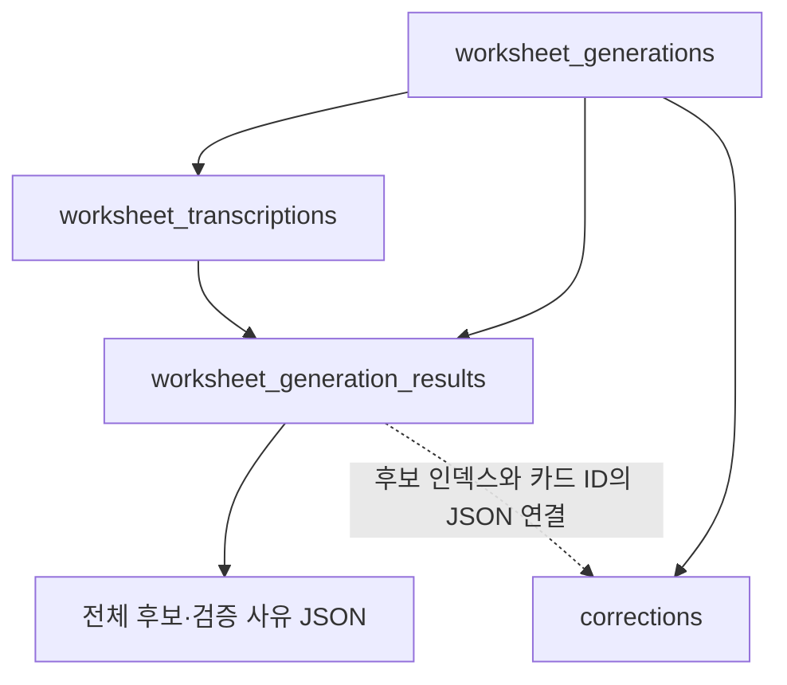

# 생성 결과 저장 설계 v1

기준: [ERD v3](../ERD%20v3%20(corrections%20확장).md),
[AI 공통 응답 계약 v1](AI-공통-응답-계약-v1.md).
이번 범위는 ORM 저장 구조와 내부 저장·복원 서비스다. 실제 AI 호출, 생성 API 실행 흐름,
프론트 조회 API의 새 응답 및 공유·운영 DB 마이그레이션은 연결하지 않았다.

## 1. 저장 구조

| 저장 위치 | 책임 |
| --- | --- |
| corrections | 검증을 통과한 REPLACE/GUIDANCE와 교사가 현재 편집하는 내용 |
| worksheet_transcriptions | 기준 PNG와 연결된 불변 전사 버전 |
| worksheet_generation_results | 생성 작업·페이지·전사 참조, 최초 응답, 전체 검증 결과와 카드 연결 |



전사와 결과는 created_at만 갖는 추가 기록이다. 수정·삭제용 repository 메서드를 노출하지 않고
Hibernate Immutable 및 updatable=false로 ORM 갱신을 막는다.
생성 작업+페이지마다 전사와 결과를 각각 하나만 허용하는 UNIQUE 제약을 둔다.
정확히 같은 저장 요청은 기존 ID를 반환하며 다른 내용으로 덮어쓰지 않는다.
새 응답·전사 버전은 새 생성 작업으로 추가한다.

## 2. Correction의 v3 확장

| 추가 필드 | 저장 내용 |
| --- | --- |
| action | REPLACE 또는 GUIDANCE. REVIEW는 이 테이블에 저장하지 않음 |
| feedback_type | CORRECTION 또는 SUGGESTION |
| issue_kinds | 중복 없는 일반 첨삭 문제 종류 JSON 배열 |
| anchor | transcription_id, line_id, occurrence, start, end JSON |
| location_uncertain | 모델이 위치를 불확실하게 판단한 원래 값 |
| warnings | 서버 검증 코드·필드 경로·설명 JSON 배열 |
| requires_review | 모델 위치 불확실성 또는 서버 경고에 따른 추가 검토 여부 |

전사 ID는 ERD v3대로 anchor JSON 안의 논리 참조다. 그 JSON 값에 DB FK를 걸지는 않는다.
결과 테이블의 transcription_id는 실제 FK이며 저장 서비스가 카드의 논리 참조와 일치시킨다.
start/end는 해당 전사 줄 안의 UTF-16 위치이고 end는 미포함이다.

REPLACE는 ai_initial_content/content에 최초 교체 제안을 저장하며 빈 문자열 삭제도 보존한다.
GUIDANCE는 같은 필드에 영어 보완 안내를 저장하고 area는 CONTENT_SUMMARY로 제한한다.
original_text는 anchor 원문이고 explanation은 최초 설명이다.
regions는 검증된 boxes를 x=left, y=top, width=right-left, height=bottom-top으로 변환한
0~1 정규화 좌표이며 pageId를 붙인다. 좌표가 없으면 빈 배열과 경고를 보존한다.

교사 편집·삭제·복원은 기존 content, is_edited, status 등의 생애주기만 바꾼다.
최초 내용·원문·영역·좌표 및 추가 계약 필드는 갱신하지 않는다.
GUIDANCE의 빈 내용은 엔티티에서도 거부한다. 현재 PATCH DTO의 NotBlank 규칙 변경은 다음 API 단계의 대상이다.

### 기존 데이터와의 전환

기존 Mock/과거 Correction에는 확정 전사·분류가 없으므로 임의의 값이나 가짜 anchor를 채우지 않는다.
새 7개 필드는 전환 기간 동안 SQL nullable로 두되, DB CHECK가 **모두 NULL인 기존 행 또는
필수값을 모두 채운 v1 행**만 허용한다. 일부 필드만 채우거나 REVIEW를 Correction에 넣는 것은 거부한다.
새 v1 저장 서비스는 항상 일곱 필드를 채우고 Java에서도 값·조합을 검사한다.
ERD v3의 일곱 NOT NULL 요구는 v1 행에 적용하며, 과거 데이터 이관 및 물리 NOT NULL 강화는 별도 작업이다.

## 3. 불변 전사문

worksheet_transcriptions는 다음 정보를 보존한다.

- 생성한 generation_id, page_id, 당시 page_number
- 요청 당시 원본 파일의 source_file_hash
- 당시 보정 PNG의 UUID 저장 URL인 source_image_url, SHA-256, 실제 픽셀 크기
- 전사 모델, normalization_version=LF-PRESERVE-v1
- transcription_text(LONGTEXT), UTF-8 기준 text_hash

transcriptionId 자체가 전사 버전을 식별한다. 별도의 증가 번호를 경쟁적으로 계산하지 않는다.
빈 줄·공백·마지막 빈 줄을 유지한 줄 배열을 LF로 연결해 저장하고 동일하게 복원한다.
읽을 글이 없는 전사는 정상 전사로 등록하지 않는다.
페이지의 ocr_result/ocr_file_hash는 교체 시 지워지는 캐시이며 이 전사 테이블을 대체하지 않는다.

공개 pages.imageUrl은 파일 교체 후 새 PNG를 가리킬 수 있으므로 전사 출처로 저장하지 않는다.
당시 UUID 파일 URL과 해시를 고정한다. 이전 단계에서 교체 전 파일을 보존하므로 과거 이미지와 대조할 수 있다.
같은 페이지·원본 파일·PNG에 대한 재시도는 기존 transcriptionId를 재사용할 수 있다.
새 파일의 전사는 새 행이며 이전 텍스트·해시·크기를 덮어쓰지 않는다.

## 4. 원본 응답과 검증 결과

worksheet_generation_results는 generation_id, page_id, transcription_id FK를 갖는다.
model/contract_version/prompt_version/validation_version을 저장 당시 값으로 보존한다.
검증 버전은 AUTEDI-VALIDATION-v1이며 규칙 변경 시 별도 버전으로 구분해야 한다.

| 필드 | 의미 |
| --- | --- |
| raw_response | LONGTEXT. JSON 재직렬화 없이 공백·줄바꿈·한국어·이모지를 포함한 원문 문자열 |
| validation_result | AiValidationResult 전체 JSON. 원본 후보·전사/설정 문맥·분류·유효 박스·사유·요약 |
| correction_links | 원본 candidateIndex와 실제 Correction ID의 연결 배열 |
| status | VALIDATED 또는 UNREADABLE |
| parse_error | 해석할 수 없는 응답의 실패 사유 |

정상 카드만 corrections에 물리 행으로 만들며 REVIEW·원문 불일치·제외·상한 초과 후보는
validation_result의 candidates에 원본과 사유를 모두 남긴다. 복원한 객체의 reviewIssues()/excludedItems()로 구분한다.
개별 확인 항목 테이블은 추가하지 않았다. 계약이 허용한 생성 결과 JSON 보존 방식을 채택했다.
확인 항목을 teacher Comment와 혼용하지 않는다.

구조를 읽을 수 없는 응답은 UNREADABLE, validation_result=NULL, correction_links=[], parse_error로 저장한다.
이미 커밋한 전사는 유지된다. items=[]는 VALIDATED인 정상 성공이고 임의의 카드를 만들지 않는다.
결과와 정상 카드는 하나의 트랜잭션으로 저장하므로 둘 중 일부만 남지 않는다.

## 5. 서비스 진입점과 검사

GenerationResultStorageService의 메서드는 다음과 같다.

- recordTranscription: 생성 요청과 같은 학습지·원본 파일·보정 PNG를 확인해 전사 버전 저장.
- recordValidatedResult: raw 응답을 읽고, 확정 전사·생성 요청 설정으로 기존 검증기를 다시 실행해
  전달된 검증 객체와 일치하는지 확인. 현재 화면 PNG와 다른 이미지에 활성 카드를 만들지 않음.
- recordUnreadableResult: 파서가 읽을 수 없는 원문 응답 및 실패 사유를 보존.
- restoreTranscription/restoreResult: 학원 소유권을 검사한 뒤 불변 DTO로 복원.

다른 학원·다른 학습지의 전사/작업 혼합, 원본 파일 해시 불일치, 다른 모델·계약·검증 버전,
위조된 검증 문맥은 거부한다. 같은 작업의 다른 결과는 최초 기록을 덮어쓰지 않는다.
검증은 저장 시에 수행하며 조회 시 현재 규칙으로 결과를 다시 계산하지 않는다.

호출 순서는 생성 작업 커밋 → 전사 저장·커밋 → 응답 해석·검증 → 결과 저장이다.
이 순서를 전체 하나의 외부 트랜잭션으로 감싸면 전사도 함께 롤백될 수 있으므로,
향후 생성 흐름은 단계별 트랜잭션 경계를 유지해야 한다.
이번 단계는 기존 생성 API/Mock에 연결하거나 작업 상태를 SUCCEEDED/FAILED로 바꾸지 않는다.
실제 생성 흐름에서 과거 활성 카드 처리 및 상태 전환을 연결하는 것은 다음 단계다.

## 6. 로컬 검증과 적용 범위

```powershell
$env:JAVA_HOME = 'C:\Users\82108\.jdks\temurin-21.0.11-1'
.\gradlew.bat --offline -I scripts/local-h2-tests.init.gradle test --tests "*GenerationResultStorageTest"
.\gradlew.bat --offline -I scripts/local-h2-tests.init.gradle build spotlessCheck
```

init 스크립트는 명시적으로 실행한 Test JVM만 test 프로파일·메모리 H2·create-drop으로 고정한다.
저장 테스트는 별도의 jdbc:h2:mem:autedi_archive_storage를 사용하고, 커밋·정리 전에 실제 JDBC URL을 검사한다.
테스트를 외부 트랜잭션으로 감싸지 않고 서비스의 실제 트랜잭션을 커밋한 뒤 새 컨텍스트로 재조회한다.
전용 메모리 DB의 데이터는 테스트 종료 시 제거된다.

검증 항목은 전체 후보/7개 필드/정규화 좌표 JSON 복원, 64KB 초과 원문 보존,
교사 편집·삭제·복원 후 최초 결과 보존, 이미지 교체·OCR 캐시 변경 후 과거 전사 보존,
파싱 실패·빈 성공, 중복/덮어쓰기 방지, 결과·카드 동시 롤백, 테넌트·문맥 검사,
재시도의 전사 재사용 및 DB CHECK의 부분 필드·REVIEW 저장 거부다.

공유·운영 DB에는 연결하거나 DDL을 적용하지 않았다. main의 DB 설정과 자동 마이그레이션 파일도 변경하지 않았다.
운영/공유 DB에 적용할 ALTER·백필·검증·배포는 별도 승인과 단계가 필요하다.
H2의 ORM 저장·복원 결과이며 실제 MySQL 마이그레이션 호환성 검증을 완료했다는 뜻은 아니다.
